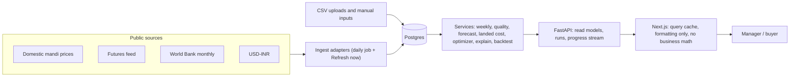

# SoyBuy: Truth, Wiring and UI/UX Implementation Plan

| Field | Value |
|---|---|
| Project | SoyBuy, PS-035, Sakthi Hackathon 2.0, Team SKH2-2026-00462 |
| Version / date | 1.0, 11 October 2026 |
| Based on | An audit of the seven dashboard screenshots and `CODEBASE.md`. **The source code itself was not reviewed**, so every finding is confirmed in Step 0 (section 3) before it is fixed |
| Relationship to the Master Spec | `SoyBuy_Master_Spec.md` still governs formulas, schema and the zero-hallucination protocol. This plan **overrides** it on three things: UI design, data sourcing for the prototype, and the claims policy. New schema changes are in migration 0004 (section 7) |
| Audience | A developer, or an AI coding assistant working under a developer's review |

---

## 0. How to use this document

1. Do **Step 0** (section 3) first and record the results in `docs/AUDIT.md`.
2. Work through the work packages (section 5) in order. Each ends with acceptance checks. A package is not done until its checks pass.
3. The design rules (section 1.3) and the data rules (section 1.1) apply to every change. The CI guard in section 10 enforces them automatically.
4. Items marked **[VERIFY]** depend on an external fact nobody has checked yet (a data source, a tax rule, a hosting limit). Check them at the source and record the result in `docs/data-sources.md`.
5. Items marked **[DEFAULT]** are starting values chosen by the designers, not facts. Tune them with evidence.
6. Items marked **[ESTIMATE]** are rough effort guesses.

---

## 1. Ground rules (non-negotiable)

### 1.1 Data integrity rules

| ID | Rule |
|---|---|
| DR-1 | Public market data (domestic mandi prices, international futures, USD-INR, World Bank monthly) comes only from real sources through ingest adapters, or from committed **real** downloaded snapshots with the source URL and retrieval date recorded. It is never generated |
| DR-2 | Synthetic data is allowed only in `tests/` fixtures and in `data/demo/` for DEMO_MODE. It is always stored with `data_origin = 'sample'` and always triggers a visible SAMPLE banner |
| DR-3 | Client-specific inputs (capacity, safety stock, lot sizes, lead times, fees, duty) are values entered by a user. Each carries a source tag: `client_confirmed`, `team_assumption` or `unverified_external`. Team assumptions are allowed but always show an "Assumed" tag until ABT-CPD confirms them |
| DR-4 | Every number on screen is computed by the API from stored data. The frontend formats and arranges; it does **no business math** (no costs, totals, deltas or percentages computed in React). Chart geometry (for example a band height from p10 and p90) is allowed |
| DR-5 | One computation per quantity. Landed cost, plan cost and route gap are computed once per plan run, stored, and read by every screen |
| DR-6 | No in-memory fallback outside DEMO_MODE. Without a database the API reports not ready and serves no numbers. Local development uses Postgres in Docker |
| DR-7 | If real data is too short for a model, the UI states what ran and why. It never shows the aspirational label |
| DR-8 | Metrics (MAPE, coverage, skill, savings) are read from stored runs. None is typed into code or text |
| DR-9 | Nothing pretends history happened. The decision log starts empty. No pre-approved sample decisions |

### 1.2 What "real-time" means here (and what it does not)

| Claim | Meaning |
|---|---|
| Computed on request | Every response is calculated from the current database state and the active settings. Nothing is a stored literal |
| Fresh data | A scheduled daily ingest plus a "Refresh now" action that runs ingest, quality checks, forecast and recommendation in sequence |
| Live progress | Long runs stream progress to the browser (server-sent events, with polling as fallback) |
| Visible age | Every panel shows its "as of" time. Staleness is computed from data, using the thresholds in the Master Spec (C.3.7) |
| Not claimed | Tick-level or intraday prices. The sources update daily or monthly. The UI never implies otherwise |

### 1.3 Design rules

| ID | Rule |
|---|---|
| D-1 | **No gradients anywhere**: not linear, radial, conic, mesh, or text gradients |
| D-2 | **No glow, blur or glassmorphism**: no `backdrop-filter`, no coloured box-shadow glows |
| D-3 | Flat solid fills, 1 px borders, and a single small solid shadow reserved for overlays (menus, dialogs) |
| D-4 | Colour carries meaning only: route identity (domestic, import) and status (success, warning, danger). Never decoration |
| D-5 | Numbers use tabular figures and always show their unit |
| D-6 | Each screen has exactly one primary action |
| D-7 | No decorative badges. Every badge or chip is a computed state |
| D-8 | Charts use direct labels, no 3D, no unlabelled dual axes, and are never the only way to read the data (a table view always exists) |
| D-9 | Light and dark themes both ship, each meeting WCAG 2.2 AA contrast (verified values in section 8.1) |

### 1.4 Claims policy (UI, deck, video, README)

| Do not say | Say instead (only when the data supports it) |
|---|---|
| "Proven 4.18% savings" | "On {period} of real public prices, with {actual or simulated} demand, SoyBuy's average cost was {x}% {lower or higher} than the reorder-point rule (95% interval {a}% to {b}%, {n} windows)." |
| "Fact Verified", "Audit Trace: Pass" | A **Sources** button that opens the provenance drawer (section 8.4) |
| "Zero-Hallucination Protocol Compliant" | Nothing. Or: "Recommendation text is generated from templates and stored facts" |
| "Zero point-in-time leakage" | "Replay uses only data published before each decision" and only after test PT-BT-01 exists and passes |
| "Quantile GBM with CQR" | "Model used for this horizon: {model_name}", read from the forecast run |
| "Production-ready" while any fallback or sample path exists | "Prototype" |
| "Real-time" | "Updated {timestamp}. Data refreshes daily and on demand" |

---

## 2. Findings to fix

Evidence comes from the screenshots and `CODEBASE.md`. Step 0 confirms each one against the code.

| ID | Finding | Evidence | Work package |
|---|---|---|---|
| F-01 | Market series look generated, not ingested | `CODEBASE.md`: `data_store.py` "initializes 52 weeks of realistic" mock series and "pre-warms mock series" | WP-1 |
| F-02 | API serves numbers without a database | `CODEBASE.md`: "in-memory fallback state" when `DATABASE_URL` is missing | WP-1, WP-11 |
| F-03 | Forecast values look typed, not modelled | Round numbers (48,750; 49,100; 49,300); p50 rises every week while p10 falls every week | WP-2 |
| F-04 | History is shorter than the model needs | 52 weeks generated; the spec needs at least 156 weeks for gradient boosting | WP-2 |
| F-05 | Figures disagree between screens | Import gap 9,155 vs 9,979; domestic landed 50,023 vs 52,247; import landed 40,868 vs 42,268; 12-week spend 15.4 Cr vs 8.66 Cr | WP-3 |
| F-06 | A test constant appears as a live figure | The Hub shows domestic unit cost 50,023, the same value as golden test GT-LC-02 (50,023.73) | WP-3 |
| F-07 | Band width and confidence disagree | Hub text says 6.8%; the week-4 forecast band is (51,890 - 47,150) / 49,520 = 9.6%. Under spec rule C.9.4, 6.8% would be "High", but the card says "Medium" | WP-4 |
| F-08 | A seeded decision is fabricated | Audit log entry "dec-init-01" with an invented business reason | WP-1 |
| F-09 | "Proven savings" rest on sample data | Replay tab headline "Saved 4.18%" under a SAMPLE badge, one window, no interval, one baseline | WP-5 |
| F-10 | No test behind the leakage claim | The 9 listed tests include no look-ahead test (PT-FCT-02, PT-BT-01 absent) | WP-5, WP-10 |
| F-11 | Frontend may compute locally | `CODEBASE.md`: sliders "update responsive simulation state"; decision history "updated locally" | WP-6, WP-7 |
| F-12 | Settings are incomplete and hide constants | 9 editable fields, while duty, port charges, inland rail, mandi fee and commission appear in the cost table | WP-3 |
| F-13 | PS-035 requirements are missing from the UI | No history view, no seasonal or cyclical view, no CSV upload, no manual market input, no stock-cover chart, no data freshness | WP-8 |
| F-14 | Decorative claims | "Fact Verified", "Audit Trace: Pass" badges and the "Zero-Hallucination Protocol Compliant" footer | WP-8, WP-10 |
| F-15 | Large import advantage is unexplained | About 19% gap, but only 400 t of import recommended with storage room. No on-screen answer to "why not more import?" | WP-4 |
| F-16 | One file holds the whole UI | `CODEBASE.md`: `page.tsx` contains all 7 tabs and the modals | WP-7 |
| F-17 | No real user | The header shows a fixed "Lead Buyer" | WP-7 |
| F-18 | Narrative text is hard-coded | Hub reason: "Pre-booking now locks favorable Kharif arrival lows". It is not derived from data, and the logic (buy now to catch harvest lows) is questionable | WP-4 |
| F-19 | Visual issues | Gradients, glow and glass styling; grey labels that look low-contrast; large empty areas; the forecast drawn as bars with no history; no chart library | WP-7, WP-8 |

---

## 3. Step 0: baseline audit (do this first, about half a day)

Run from the repository root. `rg` is ripgrep. On Windows PowerShell without ripgrep, use `Select-String -Path (Get-ChildItem apps -Recurse -Include *.py,*.ts,*.tsx) -Pattern "<pattern>"`.

**3.1 Find literals that should never be literals**

```
rg -n "48500|48,500|49520|49,520|50023|50,023|42268|42,268|40868|9979|9,979|9155|9,155|4\.18|3\.78|8\.66|15\.4|dec-init|Lead Buyer" apps
```

**3.2 Find generated or fallback data in the API**

```
rg -n "np\.random|random\.|mock|fake|dummy|synthetic|simulate|in-memory|offline|fallback" apps/api/app
```

**3.3 Find what the frontend actually calls**

```
rg -n "fetch\(|axios|/api/v1|useState\(\s*\[|const [A-Za-z_]+ = \[\s*\{" apps/web/src
```

**3.4 Find banned styling**

```
rg -n "gradient|glow|backdrop|glass" apps/web
```

**3.5 Browser check.** Open DevTools, Network tab. Reload the dashboard. Move each scenario slider once. Approve a recommendation. Save settings. Write down which requests fire. Any action with no request is client-only.

**3.6 Database check** (skip if no database is connected, which is itself finding F-02)

```sql
select data_origin, count(*) from price_observations group by 1;
select series_id, min(week_start), max(week_start), count(*) from weekly_prices group by 1;
select count(*) from decisions;
```

**3.7 Behaviour checks**

1. Call `POST /forecast/runs` twice with no data change. Results must be identical.
2. Change one stored price. The next forecast must change.
3. Change one setting (for example the lot size). The plan must change.

**3.8 Record results.** In `docs/AUDIT.md`, one row per finding F-01 to F-19: confirmed, not confirmed, or partly, with the file and line. Fix what is confirmed. The CI guard (section 10) catches the rest from now on.

---

## 4. Target architecture



### 4.1 Refresh chain

`POST /data/refresh` creates a `refresh_runs` row and executes, in order: ingest, quality checks, forecast (both targets), plan and recommendation, counterfactuals. Each step writes progress to the run record and the browser receives it over the event stream. A step failure stops the chain and shows which step failed and why. Nothing downstream runs on stale or failed inputs.

### 4.2 Single source of truth per quantity

| Quantity | Computed in | Stored in | Read by |
|---|---|---|---|
| Landed cost per route per order week | `services/landed_cost.py`, called once per plan run | `plan_runs.result.landed_cost` | Today, Cost, Scenarios, Brief |
| Plan lines, totals, stock path | `services/optimizer.py` | `plan_runs.result`, `plan_lines` | Today, Scenarios, Decisions, Brief |
| Forecast quantiles and metrics | `services/forecast.py` | `forecast_values`, `model_metrics` | Today, Forecast, Evidence |
| Facts, headline, reasons | `services/explain.py` | `recommendations.facts`, `reasons` | Today, Decisions, Brief |

A test (section 10) asserts these agree across endpoints to the rupee, which would have caught finding F-05.

### 4.3 Caching

Cache plan and scenario results by a hash of: settings version id, domestic and international forecast run ids, stock snapshot date, consumption rate, lead weeks, pipeline, and the override object. Same inputs return the stored result. Different inputs recompute. Cached entries record the hash so provenance stays exact.# SoyBuy: Truth, Wiring and UI/UX Implementation Plan

| Field | Value |
|---|---|
| Project | SoyBuy, PS-035, Sakthi Hackathon 2.0, Team SKH2-2026-00462 |
| Version / date | 1.0, 11 October 2026 |
| Based on | An audit of the seven dashboard screenshots and `CODEBASE.md`. **The source code itself was not reviewed**, so every finding is confirmed in Step 0 (section 3) before it is fixed |
| Relationship to the Master Spec | `SoyBuy_Master_Spec.md` still governs formulas, schema and the zero-hallucination protocol. This plan **overrides** it on three things: UI design, data sourcing for the prototype, and the claims policy. New schema changes are in migration 0004 (section 7) |
| Audience | A developer, or an AI coding assistant working under a developer's review |

---

## 0. How to use this document

1. Do **Step 0** (section 3) first and record the results in `docs/AUDIT.md`.
2. Work through the work packages (section 5) in order. Each ends with acceptance checks. A package is not done until its checks pass.
3. The design rules (section 1.3) and the data rules (section 1.1) apply to every change. The CI guard in section 10 enforces them automatically.
4. Items marked **[VERIFY]** depend on an external fact nobody has checked yet (a data source, a tax rule, a hosting limit). Check them at the source and record the result in `docs/data-sources.md`.
5. Items marked **[DEFAULT]** are starting values chosen by the designers, not facts. Tune them with evidence.
6. Items marked **[ESTIMATE]** are rough effort guesses.

---

## 1. Ground rules (non-negotiable)

### 1.1 Data integrity rules

| ID | Rule |
|---|---|
| DR-1 | Public market data (domestic mandi prices, international futures, USD-INR, World Bank monthly) comes only from real sources through ingest adapters, or from committed **real** downloaded snapshots with the source URL and retrieval date recorded. It is never generated |
| DR-2 | Synthetic data is allowed only in `tests/` fixtures and in `data/demo/` for DEMO_MODE. It is always stored with `data_origin = 'sample'` and always triggers a visible SAMPLE banner |
| DR-3 | Client-specific inputs (capacity, safety stock, lot sizes, lead times, fees, duty) are values entered by a user. Each carries a source tag: `client_confirmed`, `team_assumption` or `unverified_external`. Team assumptions are allowed but always show an "Assumed" tag until ABT-CPD confirms them |
| DR-4 | Every number on screen is computed by the API from stored data. The frontend formats and arranges; it does **no business math** (no costs, totals, deltas or percentages computed in React). Chart geometry (for example a band height from p10 and p90) is allowed |
| DR-5 | One computation per quantity. Landed cost, plan cost and route gap are computed once per plan run, stored, and read by every screen |
| DR-6 | No in-memory fallback outside DEMO_MODE. Without a database the API reports not ready and serves no numbers. Local development uses Postgres in Docker |
| DR-7 | If real data is too short for a model, the UI states what ran and why. It never shows the aspirational label |
| DR-8 | Metrics (MAPE, coverage, skill, savings) are read from stored runs. None is typed into code or text |
| DR-9 | Nothing pretends history happened. The decision log starts empty. No pre-approved sample decisions |

### 1.2 What "real-time" means here (and what it does not)

| Claim | Meaning |
|---|---|
| Computed on request | Every response is calculated from the current database state and the active settings. Nothing is a stored literal |
| Fresh data | A scheduled daily ingest plus a "Refresh now" action that runs ingest, quality checks, forecast and recommendation in sequence |
| Live progress | Long runs stream progress to the browser (server-sent events, with polling as fallback) |
| Visible age | Every panel shows its "as of" time. Staleness is computed from data, using the thresholds in the Master Spec (C.3.7) |
| Not claimed | Tick-level or intraday prices. The sources update daily or monthly. The UI never implies otherwise |

### 1.3 Design rules

| ID | Rule |
|---|---|
| D-1 | **No gradients anywhere**: not linear, radial, conic, mesh, or text gradients |
| D-2 | **No glow, blur or glassmorphism**: no `backdrop-filter`, no coloured box-shadow glows |
| D-3 | Flat solid fills, 1 px borders, and a single small solid shadow reserved for overlays (menus, dialogs) |
| D-4 | Colour carries meaning only: route identity (domestic, import) and status (success, warning, danger). Never decoration |
| D-5 | Numbers use tabular figures and always show their unit |
| D-6 | Each screen has exactly one primary action |
| D-7 | No decorative badges. Every badge or chip is a computed state |
| D-8 | Charts use direct labels, no 3D, no unlabelled dual axes, and are never the only way to read the data (a table view always exists) |
| D-9 | Light and dark themes both ship, each meeting WCAG 2.2 AA contrast (verified values in section 8.1) |

### 1.4 Claims policy (UI, deck, video, README)

| Do not say | Say instead (only when the data supports it) |
|---|---|
| "Proven 4.18% savings" | "On {period} of real public prices, with {actual or simulated} demand, SoyBuy's average cost was {x}% {lower or higher} than the reorder-point rule (95% interval {a}% to {b}%, {n} windows)." |
| "Fact Verified", "Audit Trace: Pass" | A **Sources** button that opens the provenance drawer (section 8.4) |
| "Zero-Hallucination Protocol Compliant" | Nothing. Or: "Recommendation text is generated from templates and stored facts" |
| "Zero point-in-time leakage" | "Replay uses only data published before each decision" and only after test PT-BT-01 exists and passes |
| "Quantile GBM with CQR" | "Model used for this horizon: {model_name}", read from the forecast run |
| "Production-ready" while any fallback or sample path exists | "Prototype" |
| "Real-time" | "Updated {timestamp}. Data refreshes daily and on demand" |

---

## 2. Findings to fix

Evidence comes from the screenshots and `CODEBASE.md`. Step 0 confirms each one against the code.

| ID | Finding | Evidence | Work package |
|---|---|---|---|
| F-01 | Market series look generated, not ingested | `CODEBASE.md`: `data_store.py` "initializes 52 weeks of realistic" mock series and "pre-warms mock series" | WP-1 |
| F-02 | API serves numbers without a database | `CODEBASE.md`: "in-memory fallback state" when `DATABASE_URL` is missing | WP-1, WP-11 |
| F-03 | Forecast values look typed, not modelled | Round numbers (48,750; 49,100; 49,300); p50 rises every week while p10 falls every week | WP-2 |
| F-04 | History is shorter than the model needs | 52 weeks generated; the spec needs at least 156 weeks for gradient boosting | WP-2 |
| F-05 | Figures disagree between screens | Import gap 9,155 vs 9,979; domestic landed 50,023 vs 52,247; import landed 40,868 vs 42,268; 12-week spend 15.4 Cr vs 8.66 Cr | WP-3 |
| F-06 | A test constant appears as a live figure | The Hub shows domestic unit cost 50,023, the same value as golden test GT-LC-02 (50,023.73) | WP-3 |
| F-07 | Band width and confidence disagree | Hub text says 6.8%; the week-4 forecast band is (51,890 - 47,150) / 49,520 = 9.6%. Under spec rule C.9.4, 6.8% would be "High", but the card says "Medium" | WP-4 |
| F-08 | A seeded decision is fabricated | Audit log entry "dec-init-01" with an invented business reason | WP-1 |
| F-09 | "Proven savings" rest on sample data | Replay tab headline "Saved 4.18%" under a SAMPLE badge, one window, no interval, one baseline | WP-5 |
| F-10 | No test behind the leakage claim | The 9 listed tests include no look-ahead test (PT-FCT-02, PT-BT-01 absent) | WP-5, WP-10 |
| F-11 | Frontend may compute locally | `CODEBASE.md`: sliders "update responsive simulation state"; decision history "updated locally" | WP-6, WP-7 |
| F-12 | Settings are incomplete and hide constants | 9 editable fields, while duty, port charges, inland rail, mandi fee and commission appear in the cost table | WP-3 |
| F-13 | PS-035 requirements are missing from the UI | No history view, no seasonal or cyclical view, no CSV upload, no manual market input, no stock-cover chart, no data freshness | WP-8 |
| F-14 | Decorative claims | "Fact Verified", "Audit Trace: Pass" badges and the "Zero-Hallucination Protocol Compliant" footer | WP-8, WP-10 |
| F-15 | Large import advantage is unexplained | About 19% gap, but only 400 t of import recommended with storage room. No on-screen answer to "why not more import?" | WP-4 |
| F-16 | One file holds the whole UI | `CODEBASE.md`: `page.tsx` contains all 7 tabs and the modals | WP-7 |
| F-17 | No real user | The header shows a fixed "Lead Buyer" | WP-7 |
| F-18 | Narrative text is hard-coded | Hub reason: "Pre-booking now locks favorable Kharif arrival lows". It is not derived from data, and the logic (buy now to catch harvest lows) is questionable | WP-4 |
| F-19 | Visual issues | Gradients, glow and glass styling; grey labels that look low-contrast; large empty areas; the forecast drawn as bars with no history; no chart library | WP-7, WP-8 |

---

## 3. Step 0: baseline audit (do this first, about half a day)

Run from the repository root. `rg` is ripgrep. On Windows PowerShell without ripgrep, use `Select-String -Path (Get-ChildItem apps -Recurse -Include *.py,*.ts,*.tsx) -Pattern "<pattern>"`.

**3.1 Find literals that should never be literals**

```
rg -n "48500|48,500|49520|49,520|50023|50,023|42268|42,268|40868|9979|9,979|9155|9,155|4\.18|3\.78|8\.66|15\.4|dec-init|Lead Buyer" apps
```

**3.2 Find generated or fallback data in the API**

```
rg -n "np\.random|random\.|mock|fake|dummy|synthetic|simulate|in-memory|offline|fallback" apps/api/app
```

**3.3 Find what the frontend actually calls**

```
rg -n "fetch\(|axios|/api/v1|useState\(\s*\[|const [A-Za-z_]+ = \[\s*\{" apps/web/src
```

**3.4 Find banned styling**

```
rg -n "gradient|glow|backdrop|glass" apps/web
```

**3.5 Browser check.** Open DevTools, Network tab. Reload the dashboard. Move each scenario slider once. Approve a recommendation. Save settings. Write down which requests fire. Any action with no request is client-only.

**3.6 Database check** (skip if no database is connected, which is itself finding F-02)

```sql
select data_origin, count(*) from price_observations group by 1;
select series_id, min(week_start), max(week_start), count(*) from weekly_prices group by 1;
select count(*) from decisions;
```

**3.7 Behaviour checks**

1. Call `POST /forecast/runs` twice with no data change. Results must be identical.
2. Change one stored price. The next forecast must change.
3. Change one setting (for example the lot size). The plan must change.

**3.8 Record results.** In `docs/AUDIT.md`, one row per finding F-01 to F-19: confirmed, not confirmed, or partly, with the file and line. Fix what is confirmed. The CI guard (section 10) catches the rest from now on.

---

## 4. Target architecture


### 4.1 Refresh chain

`POST /data/refresh` creates a `refresh_runs` row and executes, in order: ingest, quality checks, forecast (both targets), plan and recommendation, counterfactuals. Each step writes progress to the run record and the browser receives it over the event stream. A step failure stops the chain and shows which step failed and why. Nothing downstream runs on stale or failed inputs.

### 4.2 Single source of truth per quantity

| Quantity | Computed in | Stored in | Read by |
|---|---|---|---|
| Landed cost per route per order week | `services/landed_cost.py`, called once per plan run | `plan_runs.result.landed_cost` | Today, Cost, Scenarios, Brief |
| Plan lines, totals, stock path | `services/optimizer.py` | `plan_runs.result`, `plan_lines` | Today, Scenarios, Decisions, Brief |
| Forecast quantiles and metrics | `services/forecast.py` | `forecast_values`, `model_metrics` | Today, Forecast, Evidence |
| Facts, headline, reasons | `services/explain.py` | `recommendations.facts`, `reasons` | Today, Decisions, Brief |

A test (section 10) asserts these agree across endpoints to the rupee, which would have caught finding F-05.

### 4.3 Caching

Cache plan and scenario results by a hash of: settings version id, domestic and international forecast run ids, stock snapshot date, consumption rate, lead weeks, pipeline, and the override object. Same inputs return the stored result. Different inputs recompute. Cached entries record the hash so provenance stays exact.
---

## 5. Work packages

Order: WP-1 to WP-5 make the numbers true (P0). WP-6 and WP-7 wire and rebuild the frontend foundation. WP-8 and WP-9 deliver the screens and the UX system. WP-10 to WP-12 lock quality, operations and the demo.

### WP-1: Real data foundation (P0)

**Goal:** every market number comes from a real source, and the API cannot invent data.

**Tasks**

1. Replace `services/data_store.py` (mock series, in-memory state, seeded decisions) with repository modules that read and write Postgres: `repositories/prices.py`, `settings.py`, `plans.py`, `recommendations.py`, `decisions.py`. Delete all generated series and every seeded record.
2. Add `app/demo/` used **only** when `DEMO_MODE=true`: it loads CSVs from `data/demo/` into the database with `data_origin = 'sample'`. Responses carry `meta.data_origin_summary.sample = true` whenever any sample row contributed. The UI shows the SAMPLE banner from that field, not from a hard-coded badge.
3. Startup rule: outside DEMO_MODE, the API requires `DATABASE_URL`. `/ready` returns 503 if the database is unreachable or if `weekly_prices` has no rows for a required series.
4. `docker-compose.yml`: add a `db` service (Postgres) and a one-command script that applies `supabase/migrations/*.sql` in order. Local development then needs no mock path.
5. Implement and verify each adapter against the real source (Master Spec V-01 to V-06). For each: save one real response under `tests/fixtures/<source>/` with the retrieval date, write the parser test against it, and record the confirmed field names in `docs/data-sources.md`. Do not code against remembered response shapes.
6. Backfill: `python -m app.jobs.ingest_daily --backfill-from <YYYY-MM-DD>` aiming for **at least 156 weeks** per series. If a source's API cannot supply that depth, import a real downloaded CSV with `python -m app.jobs.import_snapshot --series <id> --file <path> --source-url <url> --retrieved-on <date>`. The job stores `source = 'snapshot:<url>@<date>'` in `ingest_runs`.
7. Every observation records `published_at` and `ingest_run_id`. Weekly aggregation and `known_at` follow Master Spec C.3.3 and C.3.6.
8. Quality checks run after every ingest. `/data/status` reads them from the database.
9. The decision log starts empty. Remove any initial decision records.

**Acceptance**

- AC-1.1 `scripts/no_fake_data.py` passes (Appendix A).
- AC-1.2 In real mode, `select data_origin, count(*) from price_observations group by 1` returns only `public` and `manual`.
- AC-1.3 Stopping the database makes `/ready` return 503 and the UI shows an outage state, not numbers.
- AC-1.4 Disconnecting the network leaves the app working on stored data, with a stale-data banner computed from the real latest observation date.
- AC-1.5 The Data screen shows the number of weeks of history per series.

### WP-2: Forecast engine on real data (P0)

**Goal:** the forecast is modelled from real history, honest about what ran, and measurable.

**Tasks**

1. Gate models by usable history exactly as in Master Spec C.5.2. With fewer than 156 weeks, do not run or label gradient boosting. With fewer than 104 weeks, fail with `INSUFFICIENT_HISTORY`.
2. Align the code with the Master Spec where it has drifted: parsimony tolerance is **1%** (the code guide says 2%; if you keep 2%, record an ADR and update the spec), and seasonal naive is the pure "same week last year" model.
3. Run walk-forward evaluation (C.5.5) and store per-model, per-horizon metrics in `model_metrics`: `mape_p50`, `pinball_log`, `coverage_80`, `bias_log`, `n_origins`.
4. Compute and store a skill score per horizon: `skill_vs_persistence = 1 - pinball_log(model) / pinball_log(persistence)`. Positive means the model beat the naive baseline.
5. Apply CQR calibration only to the quantile model and only with at least 20 calibration origins (C.5.7).
6. Persist run metadata: `data_hash`, `git_sha`, `config`, `model_versions`, and the per-horizon selected model.
7. Emit progress events (`loading`, `evaluating`, `fitting`, `calibrating`, `saving`) to `forecast_runs.progress`.
8. Add the live outcome view `forecast_outcomes` (migration 0004). It compares stored forecasts with prices that later actually happened, so the system keeps a running real track record.
9. Remove every hard-coded forecast, metric or label.

**Acceptance**

- AC-2.1 `PT-FCT-01` (p10 <= p50 <= p90) and `PT-FCT-02` (changing data published after the origin changes nothing) pass.
- AC-2.2 Same inputs give identical output on two runs.
- AC-2.3 Changing one past stored price changes the next forecast.
- AC-2.4 With only 120 weeks loaded (test fixture), the run uses no gradient model and the UI says "Quantile model needs 156 weeks; {n} available".
- AC-2.5 The model name shown per horizon equals `forecast_values.model_name`.

### WP-3: One landed-cost source and complete settings (P0)

**Goal:** no hidden constants, no duplicated calculations, no disagreement between screens.

**Tasks**

1. List every numeric constant in `landed_cost.py`, `landed_cost_router.py`, `plan_router.py` and `data_store.py`. Move each into settings (full field list in Appendix D) or into `units.py` if it is a unit conversion.
2. Compute landed costs **once** per plan run with a single function, and store the per-week, per-route breakdown in `plan_runs.result.landed_cost`. Routers read the stored result. Ad hoc what-if calls reuse the same function with overrides applied.
3. Expand the settings model and UI to every field in Appendix D. Add `settings_versions.field_sources` (migration 0004) with a tag per field: `client_confirmed`, `team_assumption`, `unverified_external`.
4. Import stays disabled until its required fields are set (Master Spec C.11). `unverified_external` fields (duty, landing charge) show a warning wherever they affect a displayed result.
5. Reconcile the five disagreeing figures from F-05. Delete any second implementation.
6. Search for the value 50,023 and for every golden-test constant in source files outside `tests/`. None may remain.

**Acceptance**

- AC-3.1 Changing any setting in Appendix D changes the plan or the cost screen accordingly.
- AC-3.2 Automated cross-check (section 10, test X-1): the week-0 route gap on Today equals the gap on the Cost screen; plan total equals the sum of plan lines; scenario base total equals Today's plan total. All to the rupee.
- AC-3.3 `landed_cost.py` contains no numeric literal except unit constants.
- AC-3.4 Golden tests `GT-LC-01` and `GT-LC-02` still pass.

### WP-4: Explanations, counterfactuals and "why not more import?" (P0/P1)

**Goal:** answer the questions a judge or manager will ask, with computed evidence.

**Tasks**

1. **Single band figure.** Compute `band_rel_4w` once from the stored forecast and use it for both the confidence label and the text (fixes F-07). Apply Master Spec C.9.4 exactly.
2. **Seasonal wording from data only.** Generate the seasonal reason from the STL seasonal index (Master Spec C.9.3, R-SEAS). Delete the "Kharif arrival lows" text. If STL is unavailable (under 104 weeks), omit the reason.
3. **Marginal analysis (`explain_marginal`).** Given a plan and a route, re-solve with one more lot of that route forced into week 0. Report the objective change and the binding constraints in the variant (storage capacity in week W, minimum order, lead time, shortage). If the variant is infeasible, say which limit it breaks. This is a computed answer to "why not more import?" and "why not less?".
4. **Counterfactuals.** After each recommendation is generated, queue background scenarios and store results in `recommendation_counterfactuals`. Candidate set, with magnitudes taken from data, not invented:
   - FX move: the 90th percentile of absolute 4-week USD-INR change over the loaded history.
   - Domestic price move: the 90th percentile of absolute 4-week log change of the domestic benchmark, both up and down.
   - International price move: same method on the international series.
   - Import delay: +2 weeks **[DEFAULT]**.
   - Consumption: +10% **[DEFAULT]**.
   Each stored result holds: change in likely total cost, change in week-0 tonnes by route, change in shortage, and a one-line summary ("Plan unchanged" or "Order {n} t more import").
5. Add a "plan is rolling" note to the recommendation: only week 0 is advice; later weeks are indicative.

**Acceptance**

- AC-4.1 Confidence label and band text cannot disagree (unit test across 1,000 random valid forecasts).
- AC-4.2 `POST /recommendations/{id}/marginal` returns a computed answer with a binding-constraint list.
- AC-4.3 Each counterfactual's numbers equal what `POST /scenarios/run` returns for the same override.
- AC-4.4 Counterfactual chips are ready within 10 seconds of generating a recommendation **[DEFAULT]**.

### WP-5: Honest historical replay (P0)

**Goal:** a replay that tells the truth, including when SoyBuy loses.

**Tasks**

1. Implement the replay engine per Master Spec C.10 on **real** stored weekly prices. Demand comes from uploaded consumption when present; otherwise it is a constant simulated rate and every output carries the label "SIMULATED DEMAND".
2. Strategies: SoyBuy, reorder-point rule, buy-as-needed, perfect-foresight upper bound, and actual reported purchases when a purchase file exists.
3. Metrics per C.10.4: FIFO cost per tonne consumed, adjusted cost per tonne including a penalty for unmet demand, weeks below safety stock, unmet tonnes, and the forecast metrics.
4. Run rolling windows (default 52 weeks, step 13) and report mean plus a block-bootstrap 95% interval of the difference against the baseline. With less than 78 weeks of data, run one window and show "interval not available".
5. `GET /backtests/latest` reads the latest **succeeded** run. If none exists it returns 404 and the UI shows "No replay has been run" with a Run button (manager, admin). Delete any hard-coded summary route.
6. Generate the verdict sentence from the numbers with fixed rules: lower cost with an interval excluding zero, lower cost but interval includes zero ("no clear difference"), or higher cost ("SoyBuy cost more in this period"). Always show data origin, demand source, period, window count, settings used, run id and git SHA.
7. Add tests `GT-BT-01` (frozen dataset, frozen metrics) and `PT-BT-01` (permuting prices after a decision week changes nothing before it).

**Acceptance**

- AC-5.1 No replay number exists anywhere in the codebase outside stored run results.
- AC-5.2 Changing a setting and re-running changes the result.
- AC-5.3 The Evidence screen never uses the word "proven".
- AC-5.4 If the best honest result is "no clear difference", the screen says exactly that.

### WP-6: API contracts and real wiring (P0/P1)

**Tasks**

1. Add the endpoints in section 6 and keep `/docs` (OpenAPI) as the contract.
2. Generate TypeScript types from the OpenAPI document (`openapi-typescript`). CI fails if the generated file is out of date.
3. Every user action calls the API: scenario changes (debounced, previous request cancelled), settings save, upload, manual observation, decision, run triggers. No local-only state stands in for server state.
4. Add `meta` (provenance) to every read response (section 6.1).
5. Add the progress event stream (section 6.5) with polling fallback.

**Acceptance**

- AC-6.1 Playwright test E-2 (section 10): moving a slider produces exactly one `POST /scenarios/run` after the debounce, and aborts any request still in flight.
- AC-6.2 The mutation test (E-1) passes: values altered in an intercepted API response appear in the UI.

### WP-7: Frontend foundation (P1)

**Tasks**

1. Split `page.tsx` into routes (structure below). Keep Next.js 14 App Router and TypeScript strict.
2. Add libraries (pin exact versions when installing; none are assumed here): TanStack Query, Recharts, react-hook-form, zod and its resolver, Radix primitives (Dialog, Popover, Tabs, Slider, Tooltip, Toast, Switch, Select, DropdownMenu), `@supabase/ssr` and `@supabase/supabase-js`, `openapi-typescript`. Dev: Playwright, `@axe-core/playwright`, Vitest, Testing Library, `eslint-plugin-jsx-a11y`.
3. Self-host fonts with `next/font` (Inter). No external font requests at runtime.
4. Replace the fixed "Lead Buyer" with real Supabase Auth: login page, server-side session, token sent to the API, role from `GET /me`. Hide or disable actions the role cannot perform, with the reason in a tooltip.
5. Delete from Tailwind config and CSS: glow shadows, `glass-card*` classes, all gradients, backdrop filters.
6. Add the design tokens (Appendix B) and the app shell (section 8.3).
7. Add a global error boundary and a typed API client that surfaces the error code, message and request id.
8. Wire `scripts/no_fake_data.py` into CI (section 10).

```
apps/web/src/
  app/
    (auth)/login/page.tsx
    (app)/layout.tsx                 shell: nav, top bar, banners
    (app)/today/page.tsx
    (app)/forecast/page.tsx
    (app)/cost/page.tsx
    (app)/scenarios/page.tsx
    (app)/analysis/page.tsx
    (app)/evidence/page.tsx
    (app)/decisions/page.tsx
    (app)/data/page.tsx
    (app)/settings/page.tsx
    brief/[id]/page.tsx              print view
  components/
    ui/                              Button, Chip, Banner, Dialog, Drawer, Toast, Skeleton, Field, Table ...
    charts/                          ForecastChart, CostBars, StockRunway, ScenarioCompare, CoverageMap ...
    decision/                        DecisionCard, ReasonList, Counterfactuals, ProvenanceDrawer ...
  lib/
    api/                             generated types, client, hooks
    format.ts                        number, currency, date formatting (the only place with number patterns)
    auth.ts
  styles/tokens.css
```

**Acceptance**

- AC-7.1 No file in `apps/web/src` exceeds 400 lines **[DEFAULT]**.
- AC-7.2 Logging in as each role shows the right actions; the API still enforces roles.
- AC-7.3 `no_fake_data.py` passes with zero gradient or glow matches.

### WP-8: Screens (P1/P2)

Build each screen from section 9, in this order: Today, Forecast, Cost, Scenarios, Data, Settings, Decisions, Evidence, Analysis, Brief, then first-run setup. Each screen is done only when its data bindings read real endpoints, all states (section 8.6) exist, and its accessibility checks pass.

### WP-9: UX system (P2)

Implement section 8 once, then reuse: tokens, type scale, layout grid, components, charts, states, motion, accessibility, responsive behaviour, copy deck and formatting. Do not restyle per screen.

### WP-10: Quality gates (P1)

Implement section 10: the CI guard, cross-screen consistency tests, mutation test, contract tests, accessibility scans on both themes, performance budgets, and the missing golden and property tests.

### WP-11: Deployment and operations (P2)

**Tasks**

1. Validate environment variables at startup with a typed settings object. Missing required values stop the app with a clear message.
2. Production mode forbids the demo loader. A separate demo deployment (or database) uses `DEMO_MODE=true` and shows the SAMPLE banner.
3. CORS allows only the exact web origin. Add Sentry, an uptime check on `/ready`, and alerts for ingest failure, forecast failure and stale data.
4. Schedule the daily ingest and the weekly retrain-and-recommend jobs. Add a stuck-run reaper.
5. `/ready` also reports data freshness so the uptime check catches silently stale data.
6. Run a backup and restore drill once (Master Spec G.3).

### WP-12: Demo and submission (P2)

1. Record the demo on a deployment running **real** public data. If anything shown is sample or assumed, the screen already says so; do not hide the banners.
2. Use the Master Spec G.6 demo flow, adding the live "why not more import?" answer, a counterfactual chip, and the provenance drawer.
3. Deck and video follow the claims policy (section 1.4). Every number on a slide comes from a stored run id noted in the speaker notes.
4. Prepare for the questions in section 12.

---

## 6. API additions and contracts

Paths are under `/api/v1`. Types are TypeScript interfaces, so no example values are implied. All money is INR unless the field name says otherwise, quantities are tonnes, and all timestamps are ISO 8601 UTC.

### 6.1 Provenance block on every read response

```ts
interface Meta {
  generated_at: string;
  data_as_of: string;                    // newest observation used
  settings_version_id: string;
  forecast_run_ids: { domestic: string | null; international: string | null };
  plan_run_id: string | null;
  data_origin_summary: { real: boolean; sample: boolean; manual_override: boolean; assumed_settings: boolean };
  freshness: { status: "ok" | "warn" | "fail"; stale_series: string[] };
  git_sha: string;
}
```

### 6.2 `GET /dashboard` (one call for the Today screen)

```ts
interface Dashboard {
  meta: Meta;
  recommendation: null | {
    id: string; status: "pending" | "approved" | "modified" | "rejected" | "superseded";
    headline: string; review_date: string;
    confidence: { label: "low" | "medium" | "high"; band_rel_4w: number };
    week0: {
      total_tonnes: number; cover_pct_4w: number;
      domestic: { lots: number; tonnes: number; unit_cost_inr_per_t: number; cost_inr: number };
      import:   { lots: number; tonnes: number; unit_cost_inr_per_t: number; cost_inr: number };
    };
    cost_12w_inr: { low: number; likely: number; high: number };
    reasons: { id: string; text: string; fact_keys: string[] }[];
    solver: { status: "optimal" | "feasible_time_limit" | "fallback"; time_ms: number };
    binding: { week_index: number; constraint: "capacity" | "min_order" | "shortage" }[];
    rolling_note: string;
  };
  kpis: {
    stock_t: number; cover_days: number; safety_stock_t: number;
    weekly_demand_t: number; route_gap_inr_per_t: number | null; cheaper_route: "domestic" | "import" | null;
  } | null;
  forecast_domestic: ForecastLatest | null;
  stock_projection: { week_start: string; stock_t: number; arrivals_t: number; shortage_t: number }[];
  schedule: PlanLine[];
  counterfactuals: { id: string; label: string; status: "queued" | "ready" | "failed"; summary: string | null }[];
  setup: { complete: boolean; missing: string[] };       // drives the first-run checklist
}
```

When setup is incomplete, `recommendation` and `kpis` are `null`, and the UI shows the checklist with the `missing` list. The API never fills the gap with defaults.

### 6.3 Forecast, history and outcomes

```ts
// GET /forecast/latest?target=DOM_SOY_BENCH|INT_FUT_SOY
interface ForecastLatest {
  meta: Meta;
  run: { id: string; origin_week_start: string; status: "succeeded"; n_weeks_history: number };
  history: { week_start: string; value: number; is_imputed: boolean; flag: string | null }[];
  horizons: { h: number; week_start: string; p10: number; p50: number; p90: number; model: string }[];
  skill: { h: number; model: string; mape_p50: number; pinball_log: number; coverage_80: number;
           skill_vs_persistence: number; n_origins: number }[];
  notes: string[];                                        // for example "Quantile model needs 156 weeks"
}

// GET /forecast/outcomes?target=...&limit=...   (live track record, from the forecast_outcomes view)
interface ForecastOutcome { origin_week_start: string; h: number; target_week_start: string;
  p10: number; p50: number; p90: number; actual: number; inside_band: boolean; abs_pct_error: number }

// GET /series/{id}/history?from=&to=&unit=inr_per_t|usd_per_t|inr_equiv
```

### 6.4 Cost, scenarios, counterfactuals, marginal

```ts
// GET /cost/compare?week_index=0..11   (reads the stored plan run)
interface CostCompare {
  meta: Meta; week_index: number; week_start: string;
  domestic: Breakdown; import: Breakdown | null;      // null when import is disabled
  gap_inr_per_t: number | null; cheaper_route: "domestic" | "import" | null;
  gap_series: { week_index: number; low: number; likely: number; high: number }[];
  assumptions: { field: string; value: number | boolean; source: "client_confirmed" | "team_assumption" | "unverified_external" }[];
}
interface Breakdown { total_inr_per_t: number; components: { key: string; label: string; inr_per_t: number }[] }

// POST /scenarios/run
interface ScenarioRequest {
  dom_price_shock_pct: number; int_price_shock_pct: number; fx_shock_pct: number;
  import_delay_weeks: number; domestic_delay_weeks: number; consumption_change_pct: number;
  manager_view?: { dom_pct: number | null; int_pct: number | null };
  risk_weight: number;
}
interface ScenarioResponse {
  meta: Meta; overrides_applied: string[];
  base: PlanSummary; scenario: PlanSummary;
  delta: { likely_total_inr: number; week0_tonnes_domestic: number; week0_tonnes_import: number; shortage_t: number };
  solver: { status: string; time_ms: number; fallback: boolean };
}
// GET /scenarios/presets  -> presets computed from stored history (percentile moves), each with a label and the override object

// GET /recommendations/{id}/counterfactuals    POST /recommendations/{id}/marginal { route, delta_lots }
interface MarginalAnswer { route: "domestic" | "import"; delta_lots: number; feasible: boolean;
  objective_delta_inr: number | null; binding: { week_index: number; constraint: string }[]; summary: string }
```

### 6.5 Runs, data health, settings, provenance

```ts
// POST /data/refresh  -> { refresh_run_id }       GET /refresh-runs/{id}
// GET  /runs/{kind}/{id}/events   (text/event-stream; kind = forecast | backtest | refresh)
interface RunEvent { kind: string; id: string; step: string; status: "running" | "succeeded" | "failed";
  progress: number | null; message: string; at: string }

// GET /data/status     -> per series: last_observation_date, age_days, status, source, last_ingest_run, n_weeks
// GET /data/coverage?weeks=156 -> { series_id: string; weeks: { week_start: string; state: "ok" | "imputed" | "missing" }[] }[]

// GET /settings -> { values: Settings; sources: Record<string, SourceTag>; completeness: { complete: boolean; missing: string[] }; version: {...} }
// PUT /settings (manager, admin)       POST /settings/preview -> same shape as ScenarioResponse using draft settings
// GET /settings/versions

// GET /provenance/{entity}/{id}  -> { value_formula: string; inputs: { name: string; value: number | string; source: string; as_of: string }[]; run_ids: Record<string,string> }
// GET /recommendations/{id}/brief -> the data the print view needs
```

Error responses keep the Master Spec format (`error.code`, `message`, `details`, `request_id`).

---

## 7. Migration 0004

Apply as `supabase/migrations/0004_truth_and_wiring.sql`. It adds run progress, setting source tags, counterfactual storage, a refresh-run table and a live forecast-outcome view. SQL was reviewed by hand, not executed; run it on an empty project first.

```sql
-- Progress reporting for long runs
alter table forecast_runs add column if not exists progress jsonb;
alter table backtest_runs add column if not exists progress jsonb;

-- Source tag per settings field: client_confirmed | team_assumption | unverified_external
alter table settings_versions add column if not exists field_sources jsonb not null default '{}'::jsonb;

-- Refresh chain
create table if not exists refresh_runs (
  id           uuid primary key default gen_random_uuid(),
  requested_by uuid references app_user_profile(user_id),
  status       run_status not null default 'queued',
  steps        jsonb not null default '[]'::jsonb,
  created_at   timestamptz not null default now(),
  started_at   timestamptz,
  finished_at  timestamptz,
  error        text
);

-- Counterfactuals computed after each recommendation
create table if not exists recommendation_counterfactuals (
  id                uuid primary key default gen_random_uuid(),
  recommendation_id uuid not null references recommendations(id) on delete cascade,
  label             text not null,
  override          jsonb not null,
  status            text not null default 'queued' check (status in ('queued','ready','failed')),
  result            jsonb,
  computed_at       timestamptz,
  unique (recommendation_id, label)
);
create index if not exists counterfactuals_rec_idx on recommendation_counterfactuals (recommendation_id);

-- Live track record: stored forecasts compared with prices that later happened
create or replace view forecast_outcomes with (security_invoker = true) as
select fv.run_id,
       fr.target_series,
       fr.origin_week_start,
       fv.horizon_week,
       fv.target_week_start,
       fv.model_name,
       fv.p10, fv.p50, fv.p90,
       wp.value as actual,
       (wp.value between fv.p10 and fv.p90) as inside_band,
       abs(wp.value - fv.p50) / nullif(wp.value, 0) as abs_pct_error
from forecast_values fv
join forecast_runs fr on fr.id = fv.run_id and fr.status = 'succeeded'
join weekly_prices wp on wp.series_id = fr.target_series
                     and wp.week_start = fv.target_week_start
                     and wp.value is not null;

-- Access: same pattern as migration 0002
alter table refresh_runs enable row level security;
alter table recommendation_counterfactuals enable row level security;
create policy api_full_access on refresh_runs
  for all to soybuy_api using (true) with check (true);
create policy api_full_access on recommendation_counterfactuals
  for all to soybuy_api using (true) with check (true);
grant select, insert, update, delete on refresh_runs, recommendation_counterfactuals to soybuy_api;
grant select on forecast_outcomes to soybuy_api;
revoke all on refresh_runs, recommendation_counterfactuals, forecast_outcomes from anon, authenticated;
```