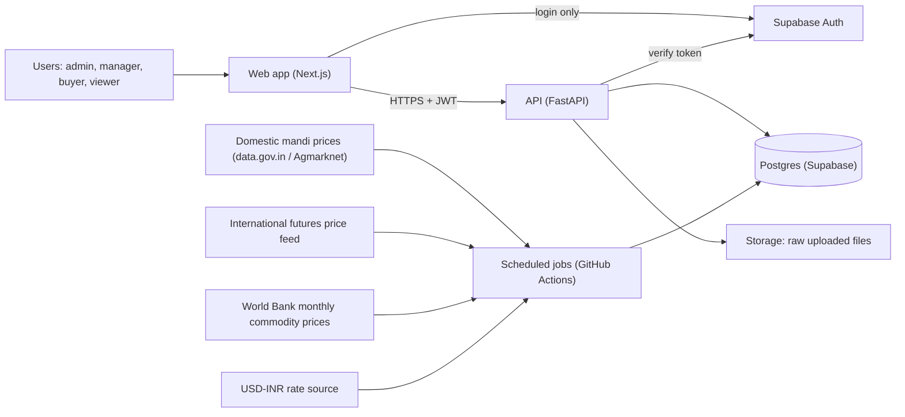
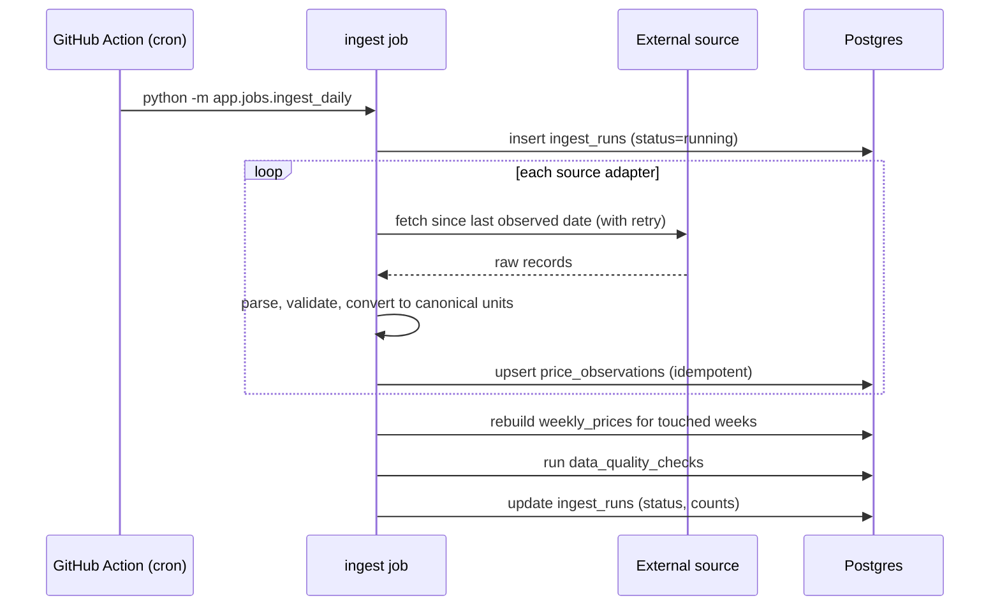
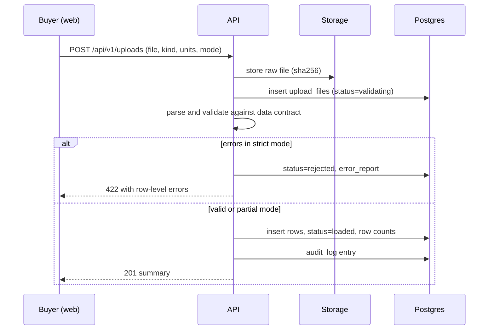
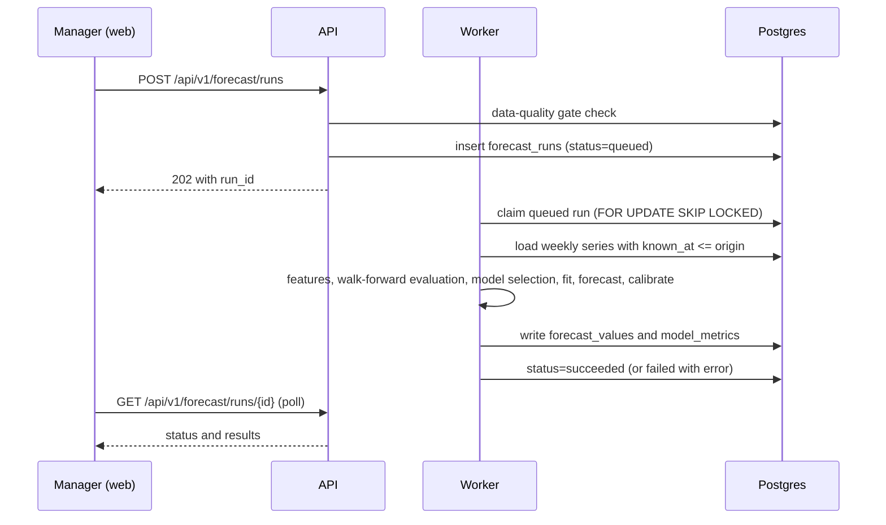
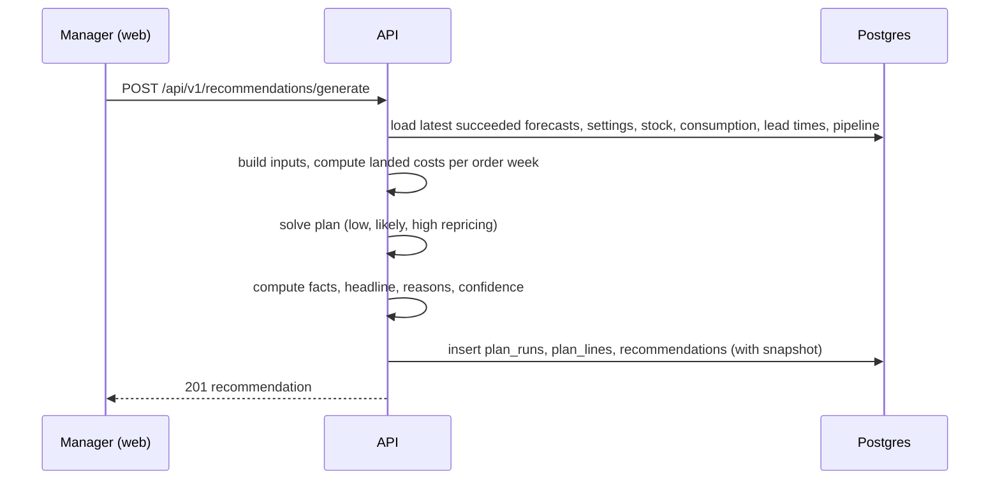
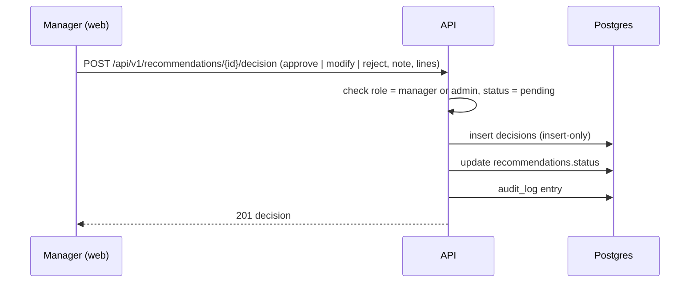
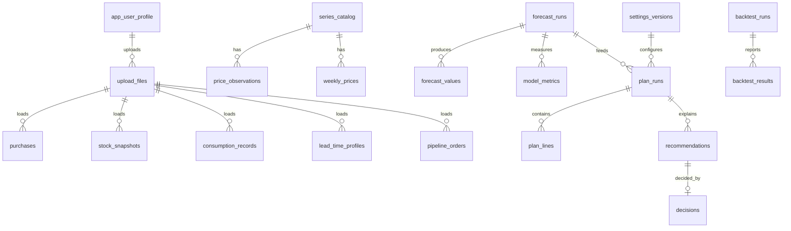

# SoyBuy Master Specification
### PRD, System Design, TRD, Database, API, Operations and Delivery Plan

| Field | Value |
|---|---|
| Product | SoyBuy: Data-Driven Dynamic Soybean Procurement Decision Support System |
| Problem statement | PS-035, Theme: AI/ML & Predictive Decision Support (THEME-04), ABT-CPD |
| Event / team | Sakthi Hackathon 2.0, Team Code SKH2-2026-00462 |
| Document version | 1.0 (baseline for build) |
| Date | 11 October 2026 |
| Status | Approved baseline. Changes only through the change process in section 0.6 |

---

## 0. Document control

### 0.1 Purpose

This is the single source of truth for building SoyBuy from an empty repository to a deployed, tested, production-ready prototype. It contains the product requirements (PRD), system design and flows, technical requirements (TRD) with exact formulas and algorithms, the database schema (DDL), the API contract, security, testing, CI/CD, operations runbooks, a work breakdown, and a register of every external fact that must be verified before it is relied on.

### 0.2 Authority order when documents conflict

1. The text of PS-035 (the problem statement).
2. Part D (database DDL) and Part C (TRD formulas and data contracts).
3. Part B (system design and flows).
4. Part A (PRD).
5. Everything else (guides, slides, notes).

A conflict is a defect. Fix the lower-authority document, or raise a change request if the higher one is wrong.

### 0.3 Conventions

| Tag | Meaning |
|---|---|
| MUST / SHOULD / MAY | Mandatory / recommended / optional |
| **[ASSUMPTION]** | A design choice or guess that ABT-CPD or PS-035 did not state. Confirm with the client when possible |
| **[VERIFY]** | An external fact (law, rate, API field, product limit) that was not checked while writing this spec. Verify at the source before building on it. See Part G, section G.1 |
| **[DEFAULT]** | An initial tunable value chosen by the designers. It is not a market fact and must be calibrated or confirmed |
| FR-xxx / NFR-xxx | Functional / non-functional requirement IDs |
| ADR-xxx | Architecture decision record (Part G, section G.2) |

Units are always shown. Quantities are **tonnes (t)**. Domestic prices are **INR per tonne (INR/t)**. International prices are **USD per tonne (USD/t)**. Exchange rate is **INR per 1 USD**.

### 0.4 Zero-hallucination protocol (applies to every contributor, human or AI)

1. Nothing about ABT-CPD's internal operations is known beyond the text of PS-035. Every ABT-CPD-specific value (lot sizes, lead times, storage capacity, safety-stock policy, mandis used, import eligibility, payment terms, duty rates) is a **client-supplied input**. The product ships with empty fields or clearly labelled SAMPLE values, never with guessed "real" values.
2. All demo data MUST carry `data_origin = 'sample'` in the database and the UI MUST show a SAMPLE badge on any screen whose result depends on sample data.
3. External facts are never hard-coded as constants. Rates and rules live in `settings_versions`. Source facts live in `series_catalog`. Each has an owner and a verification date.
4. Every number on screen MUST be traceable to a run id and a settings version (section C.12).
5. No savings or accuracy claim appears in the UI, deck or video until a replay run produced it. The claim is shown together with the replay run id, period and stated assumptions.
6. If an API field name, endpoint, file format or rule is not confirmed, write a test against the real response first, and record the confirmed shape in `docs/data-sources.md`. Do not code against a remembered shape.
7. Unknowns go to the Open Questions list (section A.10), not into code as guesses.
8. An AI coding assistant MAY generate code but MUST NOT be the source of truth for formulas. Formulas come from this spec, and each has a golden test (section C.14).

### 0.5 How to read this document

- Product people: Part A.
- Architects: Parts B and C.
- Backend: Parts C, D, E.
- Frontend: Parts A (UX), E (API), F (frontend spec).
- Everyone: Part G (verification register, ADRs, open items).

### 0.6 Change process

Any change to a formula, schema, API shape or requirement needs: (1) a short change note stating what and why, (2) an updated test, (3) a version bump in this document's table, (4) a new ADR if it changes an architecture decision.

### Contents

- Part A: Product Requirements (PRD)
- Part B: System Design and Flows
- Part C: Technical Requirements (TRD) and Algorithms
- Part D: Database Design
- Part E: API Specification
- Part F: Frontend, Security, Jobs, Observability, Testing, CI/CD
- Part G: Verification Register, ADRs, Operations, Work Breakdown, Glossary

---

# PART A: PRODUCT REQUIREMENTS (PRD)

## A.1 Product overview

**One line:** SoyBuy tells a procurement manager when to buy soybean, how many tonnes, and whether to source domestically or by import, shows the reasons in plain language, and leaves the final decision with the manager.

**Problem (from PS-035):** Soybean is ABT-CPD's primary raw material and its price varies widely with season and with domestic and international markets. Procurement must balance price, inventory, lead time, landed cost and business requirements. The objective is to reduce procurement cost and price risk while ensuring uninterrupted availability of quality soybean.

**Solution:** A decision-support system that (1) ingests public price data and ABT-CPD's own procurement, stock and consumption data, (2) forecasts price ranges for the next 12 weeks, (3) computes total landed cost for domestic and import routes, (4) optimizes a purchase schedule under inventory and lead-time constraints, (5) explains the recommendation, (6) supports what-if scenarios and manual market inputs, and (7) proves its value through historical replay.

## A.2 Goals and non-goals

**Goals**

| ID | Goal |
|---|---|
| G1 | Recommend timing, quantity and route (domestic vs import) for soybean purchases |
| G2 | Every recommendation is understandable: a headline plus 2 to 3 numeric reasons |
| G3 | Support scenario analysis and manual updates of market inputs |
| G4 | Measure performance honestly by replaying history without look-ahead |
| G5 | Keep a full audit trail of recommendations, inputs and human decisions |
| G6 | Accept ABT-CPD's own data through simple uploads, without changing their workflow |

**Non-goals (v1)**

| ID | Not included |
|---|---|
| NG1 | Placing orders or integrating with ERP or supplier systems. Output is advice only; a person approves |
| NG2 | Hedging, futures trading or financial advice |
| NG3 | Deciding whether an import is legally permitted. Eligibility is a client-set toggle |
| NG4 | Tick-level or intraday data |
| NG5 | Multi-plant or multi-company (multi-tenant) use |
| NG6 | Modelling quality parameters (moisture, oil content) beyond a percentage allowance |
| NG7 | Commodities other than soybean |

## A.3 Users and roles

| Role | Who | Can do |
|---|---|---|
| admin | Project owner / IT | Everything, including users, benchmark definition, data-quality overrides |
| manager | Procurement head | View everything, edit settings, run forecasts and scenarios, approve / modify / reject recommendations |
| buyer | Purchase executive | View everything, upload data, run scenarios, propose modifications (cannot approve) |
| viewer | Management / auditors | Read-only |

**[ASSUMPTION]** ABT-CPD's real approval chain is unknown. v1 supports a single approver role (manager). See OQ-10.

## A.4 Success metrics

| Metric | Definition | Target |
|---|---|---|
| Forecast skill | Replay MAPE and pinball loss of the chosen model versus seasonal naive, per horizon | Must be reported. If the model does not beat seasonal naive, the system ships the baseline and says so |
| Band calibration | Share of actual prices inside the p10 to p90 band, replay | Between 70% and 90% **[DEFAULT]** |
| Plan feasibility | Plans with unflagged safety-stock breach | 0 |
| Replay result | Average cost per tonne consumed, SoyBuy vs baseline rules, with spread across start dates | Reported, **not promised**. Savings only appear if measured |
| Reproducibility | Same inputs and settings version give the same plan | 100% |
| Responsiveness | Scenario recalculation, 95th percentile | 3 seconds or less on the deployed API **[DEFAULT]**, measured in test |
| Availability (prototype) | Dashboard and API reachable during demo and evaluation windows | Monitored with uptime check |

## A.5 PS-035 requirement traceability

| PS-035 item | Covered by |
|---|---|
| Tech 1: Historical domestic and international price data | FR-DATA-01 to 04, FR-DATA-10, section C.3 |
| Tech 2: Historical ABT-CPD procurement data (quantity, price, date) | FR-DATA-05, schema `purchases` |
| Tech 3: Inventory, consumption rate, lead time, constraints | FR-DATA-06 to 09, FR-OPT-02, settings |
| Tech 4: Accommodates changing markets; manual updating of market inputs | FR-DATA-10, FR-FCT-05, FR-FCT-06, FR-SCN-04 |
| Tech 5: Understandable recommendations, not only statistics | FR-REC-01 to 03, section C.9 |
| Expected 1: Analyse historical price trends | FR-ANA-01 |
| Expected 2: Identify seasonal and cyclical patterns | FR-ANA-02, FR-ANA-03 |
| Expected 3: Forecast short and medium term | FR-FCT-01 to 04 (1 to 12 weeks) |
| Expected 4: Compare domestic vs international on total landed cost | FR-LC-01 to 06 |
| Expected 5: Recommend optimum timing and quantity | FR-OPT-01 to 06 |
| Expected 6: Scenario analysis | FR-SCN-01 to 04 |
| Expected 7: Simple recommendation / dashboard for management | FR-REC, FR-DASH |

## A.6 Functional requirements

Priority: **M** = must (release blocker), **S** = should, **C** = could.

### Data

| ID | Pri | Requirement | Acceptance |
|---|---|---|---|
| FR-DATA-01 | M | Daily ingest of domestic mandi prices (min, max, modal in INR per quintal, and arrivals if the source provides them) for the configured mandis | Re-running the same day creates zero duplicate rows; an `ingest_runs` row is written |
| FR-DATA-02 | M | Daily ingest of an international benchmark (nearby soybean futures). Store raw US cents per bushel and canonical USD/t | Unit test GT-UNIT-02 passes; roll flag set per C.3.5 |
| FR-DATA-03 | S | Monthly ingest of a long-history international monthly price (USD/t) for seasonality work | Series present with `publication_lag_days` set |
| FR-DATA-04 | M | Daily ingest of the USD-INR rate | Latest value no older than the freshness threshold, or a data-quality warning is raised |
| FR-DATA-05 | M | Upload purchases CSV (date, route, quantity, price, optional fields) | Valid rows load; invalid rows are rejected with row-level errors; raw file kept |
| FR-DATA-06 | M | Upload stock snapshots CSV | Same as above |
| FR-DATA-07 | M | Upload consumption CSV (period-based) | Same as above |
| FR-DATA-08 | M | Maintain lead times per route and supplier (CSV or form) | Used by optimizer; missing lead time blocks plan with a clear message |
| FR-DATA-09 | S | Upload open (in-transit) orders | Appear in the optimizer as pipeline arrivals |
| FR-DATA-10 | M | Manual market inputs: add or override an observation for a series and date, with a note | Stored with `source = 'manual'`, visible in audit log, flagged in charts |
| FR-DATA-11 | M | Data-quality checks (freshness, gaps, range, outliers) with pass / warn / fail | A `fail` blocks forecast runs unless an admin overrides with a written reason |
| FR-DATA-12 | M | Admin defines the domestic benchmark (which mandis, aggregation = median across selected mandis) | Benchmark series recomputes after change; change is audited |

### Analysis

| ID | Pri | Requirement | Acceptance |
|---|---|---|---|
| FR-ANA-01 | M | Price history chart for domestic, international (shown in INR/t equivalent using FX), and FX, with date range and unit toggle | Values match database; units always labelled |
| FR-ANA-02 | M | Seasonality view: seasonal index by week of year from an STL decomposition of the last N years, plus year-overlay lines | Index averages to about 1.0 over a year; N and method shown |
| FR-ANA-03 | S | Cycle view: STL trend component and year-on-year % change | Labelled as descriptive, not predictive |

### Forecasting

| ID | Pri | Requirement | Acceptance |
|---|---|---|---|
| FR-FCT-01 | M | Forecast domestic benchmark price, horizons 1 to 12 weeks, quantiles p10, p50, p90 | Stored in `forecast_values`; p10 <= p50 <= p90 for every row |
| FR-FCT-02 | M | Forecast international benchmark (USD/t), same horizons and quantiles | Same |
| FR-FCT-03 | M | Compare seasonal naive, ETS and quantile gradient boosting by walk-forward testing and select per horizon | Metrics in `model_metrics`; selection rule in C.5.6 |
| FR-FCT-04 | M | Show metrics, selected model per horizon and a plain-language confidence note | Visible on dashboard detail panel |
| FR-FCT-05 | S | Scheduled weekly retrain plus manual "Refresh forecast" | Job and button both create a `forecast_runs` row |
| FR-FCT-06 | M | Manual market view: manager enters a percentage adjustment to the likely path, optionally by 4-week block | Applied only in scenario or plan runs, logged as an override, never written into the stored forecast |

### Landed cost

| ID | Pri | Requirement | Acceptance |
|---|---|---|---|
| FR-LC-01 | M | Domestic landed cost per tonne | Golden test GT-LC-01 |
| FR-LC-02 | M | Import landed cost per tonne | Golden test GT-LC-02 |
| FR-LC-03 | M | Component-level breakdown for both routes | Components sum to the total exactly |
| FR-LC-04 | M | All rates and fees editable in a versioned settings record | Each change creates a new version with author and timestamp |
| FR-LC-05 | M | Domestic vs import comparison for each of the 12 order weeks, with low / likely / high | Chart and table |
| FR-LC-06 | M | `import_enabled` toggle. When false, import is excluded from plans | Plan contains no import lines |

### Optimization

| ID | Pri | Requirement | Acceptance |
|---|---|---|---|
| FR-OPT-01 | M | Produce a 12-week purchase plan: per week, route and lots/tonnes | Golden test GT-OPT-01 |
| FR-OPT-02 | M | Respect safety stock, storage capacity, lot sizes, minimum order, lead times and in-transit orders | Property tests PT-OPT-01 to 05 |
| FR-OPT-03 | M | Report the plan's cost under low, likely and high price paths | Three totals shown |
| FR-OPT-04 | S | Cautious mode using `risk_weight` between 0 and 1 | Changes objective prices per C.7.4 |
| FR-OPT-05 | M | Report shortage weeks and tonnes if safety stock cannot be met, instead of failing silently | Shortage block shown in UI |
| FR-OPT-06 | S | If the solver fails or times out without a feasible solution, return a clearly labelled fallback plan from a reorder-point rule | Response field `fallback = true` |

### Scenarios

| ID | Pri | Requirement | Acceptance |
|---|---|---|---|
| FR-SCN-01 | M | Controls: domestic price shock %, international price shock %, FX shock %, import delay (weeks), domestic delay (weeks), consumption change % | Each control changes the plan inputs per C.8 |
| FR-SCN-02 | M | Show base vs scenario plan and cost on the same charts | Delta values shown |
| FR-SCN-03 | S | Save and name scenarios | Stored in `plan_runs` with `kind = 'scenario'` |
| FR-SCN-04 | M | Manager's own market view (see FR-FCT-06) available in scenarios | Logged |

### Recommendation and decisions

| ID | Pri | Requirement | Acceptance |
|---|---|---|---|
| FR-REC-01 | M | Headline recommendation in one or two sentences | Generated from the plan by template (C.9) |
| FR-REC-02 | M | Two to three reasons, each a sentence containing its number | Each reason traces to a computed fact |
| FR-REC-03 | M | Confidence label (high / medium / low) | Rule in C.9.4 |
| FR-REC-04 | M | Immutable input snapshot stored with each recommendation | Reproducible by replaying the snapshot |
| FR-REC-05 | M | Manager can approve, modify (edit quantities) or reject, with optional note | Decision stored insert-only |
| FR-REC-06 | M | Decision log with filters | Paginated list |
| FR-REC-07 | S | A new recommendation marks the previous pending one `superseded` | Status updated |

### Dashboard

| ID | Pri | Requirement |
|---|---|---|
| FR-DASH-01 | M | Recommendation card at the top (headline, reasons, confidence, action buttons) |
| FR-DASH-02 | M | Forecast chart: history plus p10 to p90 band and p50 line, for domestic and international |
| FR-DASH-03 | M | Domestic vs import stacked cost comparison |
| FR-DASH-04 | M | Stock-cover timeline: projected stock, safety stock line, capacity line, arrivals |
| FR-DASH-05 | M | Procurement schedule table |
| FR-DASH-06 | M | Scenario controls |
| FR-DASH-07 | M | Data freshness badge, SAMPLE badge, data-quality banner |

### Backtest

| ID | Pri | Requirement | Acceptance |
|---|---|---|---|
| FR-BT-01 | M | Replay engine with strict point-in-time data | Test PT-BT-01 (no look-ahead) |
| FR-BT-02 | M | Compare SoyBuy with a reorder-point rule and a buy-as-needed rule; include actual purchases when a file is provided; optional perfect-foresight upper bound | Strategy list stored |
| FR-BT-03 | M | Metrics in C.10.4 | Stored in `backtest_results` |
| FR-BT-04 | S | Block-bootstrap intervals across start dates | Interval columns populated |
| FR-BT-05 | M | Reproducible runs (config, data hash, code version stored) | Golden test GT-BT-01 |
| FR-BT-06 | S | CSV export of replay results | Download works |

### Administration and platform

| ID | Pri | Requirement |
|---|---|---|
| FR-ADM-01 | M | Authentication through Supabase Auth |
| FR-ADM-02 | M | Role-based access (A.3) enforced in the API |
| FR-ADM-03 | M | Audit log of settings, benchmark, overrides, uploads and decisions |
| FR-ADM-04 | S | CSV export of plan and decision log |
| FR-ADM-05 | M | `/health` and `/ready` endpoints |

## A.7 Non-functional requirements

| ID | Requirement |
|---|---|
| NFR-01 Performance | Dashboard first load under 3 s on a normal connection **[DEFAULT]**; scenario recalculation p95 under 3 s; forecast run under 5 min for both targets |
| NFR-02 Reliability | External data failures never crash the app. Cached data is used and the freshness badge shows age |
| NFR-03 Security | All data access through the API; roles enforced; secrets in environment variables; HTTPS only |
| NFR-04 Privacy | ABT-CPD data is confidential. No personal data is collected beyond user email and name |
| NFR-05 Auditability | Every recommendation reproducible from its snapshot (inputs, settings version, model run ids) |
| NFR-06 Accuracy of units | Units are explicit in every API field name and UI label (for example `price_inr_per_t`) |
| NFR-07 Maintainability | Lint, type checks and tests in CI; no formula without a golden test |
| NFR-08 Accessibility | Keyboard-navigable controls, text alternatives for charts (data table view), sufficient colour contrast |
| NFR-09 Browser support | Current versions of Chrome, Edge, Safari, Firefox; usable on a tablet and a phone |
| NFR-10 Portability | Runs locally with one command and seed data (section G.5) |

## A.8 User stories and acceptance criteria

**US-1 See the advice.** *As a manager, I open the dashboard and see what to buy this week.*
- Given a completed forecast and plan, when I open the dashboard, then the top card shows a headline, 2 to 3 reasons, a confidence label, and Approve / Modify / Reject.

**US-2 Understand why.** *As a manager, I want each reason to cite a number.*
- Given a recommendation, then each reason contains at least one figure from the plan facts (for example the 4-week likely price change %).

**US-3 Compare routes.** *As a buyer, I compare domestic and import cost.*
- Given current settings, then the chart shows both routes per order week with a component breakdown and the difference in INR/t.

**US-4 Test a what-if.** *As a buyer, I move the FX slider by +3%.*
- Given a base plan, when I change a slider, then within 3 s I see the new plan and the cost delta against base.

**US-5 Enter my own view.** *As a manager, I believe prices will be 5% higher than the model says.*
- When I enter +5%, then the likely path shifts by 5%, the override is labelled "manual view", and it is saved in the audit log.

**US-6 Upload my data.** *As a buyer, I upload purchases.csv.*
- Given a malformed row, then the file is rejected or partially loaded per the chosen mode, with a row-by-row error report; the raw file is stored.

**US-7 Approve a plan.** *As a manager, I approve with a note.*
- Then a decision is stored with user, time, action and note, the recommendation status becomes `approved`, and the record cannot be edited.

**US-8 Trust the method.** *As an auditor, I see the replay results.*
- Then the screen shows period, strategies, metrics, assumptions, the SAMPLE badge if applicable, and the run id.

**US-9 Handle stale data.** *As a manager, if a price feed is stale, I am told.*
- Then a banner states which series are stale and by how long; a `fail` blocks a new forecast unless an admin overrides.

## A.9 UX specification

### Navigation

Top bar: logo, data-freshness badge, SAMPLE badge (when applicable), user menu. Left menu: Dashboard, Analysis, Scenarios, Decisions, Data, Settings, Backtest.

### Dashboard wireframe (desktop)

```
+----------------------------------------------------------------------+
| RECOMMENDATION (week of 2026-10-12)             Confidence: MEDIUM   |
| "Order 250 t domestic this week (about 40% of the next 4 weeks'      |
|  need). Import is about INR X/t costlier than domestic."             |
| - Reason 1 (number)   - Reason 2 (number)   - Reason 3 (number)      |
| [Approve] [Modify] [Reject]                                          |
+---------------------------------------+------------------------------+
| FORECAST: domestic INR/t              | DOMESTIC vs IMPORT (INR/t)   |
| history + p10-p90 band + p50 line     | stacked bars per component   |
| [toggle: international USD/t]         | order-week selector          |
+---------------------------------------+------------------------------+
| STOCK COVER (t): projected stock, safety line, capacity line, arrivals|
+----------------------------------------------------------------------+
| PROCUREMENT SCHEDULE: week | route | lots | tonnes | est. cost         |
+----------------------------------------------------------------------+
| SCENARIO CONTROLS: sliders + "Manual market view" + Reset            |
+----------------------------------------------------------------------+
```
(The example text and numbers above are illustrative placeholders, not results.)

### Copy and display rules

- Always show units next to numbers. Prices in INR/t with thousands separators in the Indian grouping or standard grouping as a user preference **[ASSUMPTION]**.
- Dates shown in ISO or "12 Oct 2026" format consistently. Week labels show the Monday date.
- Forecasts are shown as a band with the p50 line. Never show a single number as "the forecast" without the band.
- If a result depends on manual overrides, show a "Manual view applied" tag.
- Empty states say what to do (for example "Upload stock.csv to see stock cover").
- Errors state the cause and the fix in one sentence, with a request id for support.

## A.10 Open questions for ABT-CPD

These are unknown and MUST NOT be guessed in code. Until answered, the corresponding setting is blank or SAMPLE.

| ID | Question | Used for |
|---|---|---|
| OQ-01 | Which mandis or markets do you buy domestic soybean from, and in what proportions? | Benchmark definition (FR-DATA-12) |
| OQ-02 | Is import of soybean permitted for your use, under what conditions, and through which ports and origins? | `import_enabled`, import routes |
| OQ-03 | Typical purchase lot sizes (truck, container, shipment) and minimum order quantities per route | Lot constraints |
| OQ-04 | Lead times (order to receipt in plant) per route and supplier, and how variable they are | Optimizer |
| OQ-05 | Storage capacity and safety-stock policy (days of cover or tonnes) | Constraints |
| OQ-06 | Daily consumption rate and seasonality in consumption | Demand profile |
| OQ-07 | Purchase history: period available, columns, units, and whether prices include taxes or transport | Data contract, backtest |
| OQ-08 | Payment terms per route (days from payment to receipt) and cost of capital | Financing cost |
| OQ-09 | Cost components and current rates: market fee, commission, transport, handling, duty, port charges, insurance, quality allowance | Landed cost settings |
| OQ-10 | Who approves purchases, and above what quantity or value? | Roles and workflow |
| OQ-11 | Planning horizon the team prefers (weeks) and review rhythm | Horizon, scheduling |
| OQ-12 | Quality specification and how it affects price (for example moisture or foreign matter discounts) | Quality allowance |

## A.11 Release plan

| Release | Contents | Exit criteria |
|---|---|---|
| R0 Demo cut (Round 2) | Data ingest for domestic, international, FX; forecast bands; landed cost; plan; dashboard; scenarios; decision log; recorded demo | Demo script (G.6) runs end to end on deployed build with seeded sample data |
| R1 Production-ready prototype | Everything in A.6 marked M and S, replay, auth, tests, CI, monitoring, backups | Definition of Done (G.4) met |
| R2 Pilot (post-hackathon, needs ABT-CPD) | Real ABT-CPD data, calibrated settings, user training, approval workflow changes | Client sign-off on OQ answers and a replay on real purchases |

## A.12 Risks

| ID | Risk | Likelihood | Impact | Mitigation |
|---|---|---|---|---|
| R-01 | Public data APIs change, rate-limit or go down | Medium | High | Cache raw downloads, CSV fallback import, freshness badge, adapter layer per source |
| R-02 | Domestic series has gaps or inconsistent mandi reporting | High | Medium | Median across mandis, gap flags, imputation limited to 2 weeks and flagged |
| R-03 | Weak forecast skill (prices are noisy) | High | Medium | Quantile bands, honest comparison with naive, robust optimizer, ship baseline if it wins |
| R-04 | Look-ahead leakage inflates results | Medium | High | Point-in-time storage, publication lags, no-look-ahead tests |
| R-05 | Futures roll creates false jumps in the international series | High | Medium | Roll flag and treatment (C.3.5), cross-check with monthly series |
| R-06 | Wrong cost settings produce misleading comparison | Medium | High | Editable, versioned settings, component breakdown, sanity warnings |
| R-07 | No ABT-CPD data available during evaluation | High | Medium | Upload flow plus labelled SAMPLE data; claims limited to what was measured |
| R-08 | Free-tier hosting limits (sleep, pause) hurt the demo | Medium | Medium | Warm-up before demo, uptime pings, recorded fallback video |
| R-09 | Solver slow or fails | Low | Medium | Time limit, fallback heuristic, small model size |
| R-10 | Confidential data leakage | Low | High | RLS deny-all, API-only access, no sample/real mixing, no data in logs |

---

# PART B: SYSTEM DESIGN AND FLOWS

## B.1 System context



The web app never reads database tables directly. It only uses Supabase Auth to log in, then calls the API with the user's token. Scheduled jobs run the same Python package as the API, as command-line entry points.

## B.2 Components

| Component | Responsibility | Talks to |
|---|---|---|
| Web app | UI, charts, forms, auth session | API, Supabase Auth |
| API | Auth check, role check, validation, orchestration, reads and writes | Postgres, Storage |
| Ingest adapters | One module per external source; fetch, parse, canonicalize, upsert | External sources, Postgres |
| Data-quality service | Freshness, gap, range, outlier checks; gate for forecasts | Postgres |
| Forecast service | Features, models, walk-forward evaluation, quantile forecasts | Postgres |
| Landed-cost service | Pure functions: domestic and import cost per tonne | none (pure) |
| Optimizer service | Builds and solves the mixed-integer plan | none (pure, inputs passed in) |
| Explanation service | Facts to headline and reasons by template | none (pure) |
| Scenario service | Applies overrides, calls landed cost and optimizer | Services above |
| Backtest service | Point-in-time replay of strategies | Services above |
| Worker | Picks queued forecast and backtest runs, executes them | Postgres |
| Scheduler | Triggers ingest and retrain | GitHub Actions |

Design rule: **landed-cost, optimizer and explanation services are pure functions** (inputs in, outputs out, no database or network). That makes them fast to test and safe to reuse in the backtest.

## B.3 Core flows

### F1: Daily ingestion



A source failure does not stop other sources. The failure is logged in `ingest_runs.error` and the freshness check turns it into a visible warning or failure.

### F2: CSV upload



### F3: Forecast run (asynchronous)



### F4: Recommendation generation



### F5: Scenario recalculation

The browser sends overrides to `POST /api/v1/scenarios/run`. The API loads the same stored inputs as F4, applies the overrides in memory (section C.8), solves, and returns the plan and cost delta against base. Nothing is written unless the user chooses "Save scenario".

### F6: Decision



### F7: Backtest

A manager or admin starts `POST /api/v1/backtests`. The worker claims the run, replays week by week with point-in-time data (section C.10), writes `backtest_results`, and marks the run `succeeded`.

## B.4 Time model and point-in-time rules

1. **Week:** ISO week, Monday start. `week_start` is the Monday date. Business calendar and display time zone: Asia/Kolkata **[ASSUMPTION]**. Timestamps in the database are `timestamptz` (UTC).
2. **Origin:** the forecast origin is the last **complete** week at run time (Monday to Sunday). `origin_week_start` is that week's Monday.
3. **Horizon:** `h = 1` is the week after the origin week. `h = 1..12`.
4. **Plan weeks:** plan week index `t = 0..11` corresponds to forecast horizon `h = t + 1`. Orders in week `t` are priced at the forecast for horizon `t + 1`.
5. **Known-at:** each weekly value has `known_at` = the time all its inputs were published. For daily series, the end of the week. For monthly series, month end plus `publication_lag_days`. A feature or training row may use a value only if `known_at <= origin_end` (end of origin week).
6. **Starting stock** for plan week 0 is the latest stock snapshot on or before the run date. If older than 7 days, a data-quality warning is raised **[DEFAULT]**.
7. **Revisions:** if a source revises a past value, a new revision row is inserted and the latest revision wins for live use. Replay uses the revision known at the replay date.

## B.5 State machines

| Entity | States | Allowed transitions |
|---|---|---|
| forecast_runs, backtest_runs | queued, running, succeeded, failed, cancelled | queued to running; running to succeeded or failed; queued or running to cancelled. A run stuck in running for over 30 minutes is marked failed by the worker on start **[DEFAULT]** |
| upload_files | validating, rejected, loaded, partially_loaded | validating to any of the other three |
| recommendations | pending, approved, modified, rejected, superseded | pending to approved, modified, rejected, or superseded. Terminal states never change |
| plan_runs | stored with `solver_status` = optimal, feasible_time_limit or fallback | set once at creation. Pre-check failures (C.7.5) are returned as API errors and are not stored |

---

# PART C: TECHNICAL REQUIREMENTS (TRD)

## C.1 Technology stack

Version policy: at project start, pin **exact** versions in lock files (`uv.lock` or `requirements.lock`, `package-lock.json`). Versions are not listed here because they change; the table gives the choice and the minimum capability needed.

| Area | Choice | Notes |
|---|---|---|
| Language (API) | Python 3.11 or newer | Pin the minor version in the Dockerfile |
| API framework | FastAPI with Uvicorn | Auto OpenAPI schema is the API contract |
| Validation | Pydantic v2 | All request, response and settings models |
| DB access | SQLAlchemy 2.x Core with psycopg 3 | No ORM-driven schema creation |
| Migrations | Supabase CLI SQL migrations in `supabase/migrations/` | One tool only. Alembic is not used |
| Data and models | pandas, numpy, statsmodels, scikit-learn | scikit-learn quantile loss for `HistGradientBoostingRegressor` needs a version that supports it (confirmed working in current releases; pin) **[VERIFY minimum version]** |
| Optimization | PuLP with the bundled CBC solver | Mixed-integer linear program |
| HTTP client | httpx, with retry through tenacity | Timeouts on every call |
| Web | Next.js (App Router), React, TypeScript (strict), Tailwind CSS | Pin exact versions |
| Web data layer | TanStack Query, react-hook-form, zod | |
| Charts | Recharts | Band drawn with two stacked areas |
| Auth | Supabase Auth, `@supabase/ssr` in Next.js | API validates the access token **[VERIFY signing method, see G.1]** |
| Database | Supabase Postgres | UUIDs via `gen_random_uuid()` |
| Tests | pytest, hypothesis, pytest-cov; vitest and Testing Library; Playwright | |
| Lint and types | ruff, mypy; ESLint, tsc, Prettier | |
| Containers | Docker; docker compose for local development | |
| Hosting | Web on Vercel; API in a container on one of Render, Fly.io or Railway | Decide at start (ADR-004) |
| Observability | Sentry for web and API; structured JSON logs; uptime monitor on `/health` | |
| Scheduling | GitHub Actions cron | Cron runs in UTC and can be delayed |

Power BI is not used in v1. PS-035 lists BI tools as a suggestion ("or equivalent"); the web dashboard meets the requirement.

## C.2 Repository structure

```
soybuy/
  README.md
  docs/
    SoyBuy_Master_Spec.md          (this document)
    data-sources.md                (confirmed source shapes, filled during build)
    runbook.md
  apps/
    web/                           Next.js app
      src/app/                     routes
      src/components/
      src/lib/                     api client, formatting, units
    api/
      pyproject.toml
      app/
        main.py                    FastAPI app and lifespan
        config.py                  settings from environment
        deps.py                    auth and role dependencies
        db.py                      engine and session helpers
        routers/                   health, series, uploads, settings, forecast,
                                   plans, scenarios, recommendations, decisions,
                                   backtests, data_status, analysis, admin
        schemas/                   Pydantic models
        services/
          adapters/                agmarknet.py, futures.py, worldbank.py, fx.py
          weekly.py                weekly aggregation
          quality.py               data-quality checks
          features.py              feature engineering
          forecast.py              models, walk-forward, calibration
          landed_cost.py           pure functions
          optimizer.py             pure function
          explain.py               pure function
          scenario.py
          backtest.py
          uploads.py               parsing and validation
        jobs/                      ingest_daily.py, retrain_weekly.py, worker.py
      tests/
        unit/ integration/ golden/ property/
  supabase/
    migrations/                    0001_schema.sql, 0002_seed_catalog.sql ...
  data/seed/                       sample CSVs (all rows data_origin = sample)
  .github/workflows/               ci.yml, ingest.yml, retrain.yml, backup.yml
  docker/                          Dockerfile.api, docker-compose.yml
  .env.example
```

## C.3 Data sources, units and canonicalization

### C.3.1 Series catalog

Each series has one row in `series_catalog`. **Source details marked [VERIFY] must be confirmed against the live source before coding the adapter** (record the confirmed shape in `docs/data-sources.md`).

| series_id | Meaning | Raw unit | Canonical unit | Frequency | Source (to confirm) |
|---|---|---|---|---|---|
| `DOM_SOY_MANDI` | Modal price per mandi per day (one row per mandi, with `dimension_key` = mandi id) | INR per quintal | INR/t | daily | Agmarknet daily mandi prices via data.gov.in open API (free API key) **[VERIFY resource id, field names, date format, update timing]** |
| `DOM_SOY_BENCH` | Domestic benchmark (derived, section C.3.4) | n/a | INR/t | daily, weekly | derived |
| `DOM_SOY_ARRIVAL` | Arrivals per mandi per day, if provided | quintal or tonne | t | daily | same source **[VERIFY availability and unit]** |
| `INT_FUT_SOY` | Nearby soybean futures settlement or close | US cents per bushel | USD/t | daily | Public futures data feed **[VERIFY provider, symbol, delay, terms of use]** |
| `INT_WB_SOY` | Monthly soybean price | USD per tonne | USD/t | monthly | World Bank commodity price data (monthly file) **[VERIFY file URL, series name, release timing]** |
| `FX_USDINR` | INR per 1 USD | INR per USD | INR per USD | daily | RBI reference rate or a public FX series **[VERIFY provider and publish time]** |

### C.3.2 Unit conversions (constants, unit-tested)

| Conversion | Formula |
|---|---|
| INR per quintal to INR/t | multiply by 10 (1 t = 10 quintal) |
| kg to t | divide by 1,000 |
| US cents per bushel to USD/t (soybeans) | `usd_per_t = cents_per_bu * 0.367437` |

Derivation of the last line: 1 bushel of soybeans = 60 lb = 27.2155 kg, so 1 t = 36.7437 bushels, and USD per bushel = cents / 100. Hence USD/t = (cents / 100) x 36.7437 = cents x 0.367437. Golden test GT-UNIT-02: 1000 cents/bu gives 367.437 USD/t.

### C.3.3 Weekly grid

- Week = ISO week, `week_start` Monday.
- Weekly value of a daily series = **mean** of the daily values in that week **[DEFAULT]**, requiring at least 2 daily observations. Otherwise the week is `missing`.
- Gaps of 1 to 2 consecutive missing weeks are filled by linear interpolation in log space and flagged `is_imputed = true`. Longer gaps stay missing and trigger a data-quality failure if inside the last 26 weeks.
- Monthly series are used only for long-history seasonality and for a cross-check (C.3.7). They are not forced onto the weekly grid.

### C.3.4 Domestic benchmark

For each date `d`: `DOM_SOY_BENCH(d) = median` of canonical modal prices across the active mandis in `mandi_selection` that have data on `d`. Store `n_mandis`. Require at least 1 mandi. Admin changes to the mandi set recompute the benchmark and write an audit record. **The mandi set is a client input (OQ-01); the product does not choose it.**

### C.3.5 International series and futures roll

The feed may be a continuous "nearby" series that jumps when the front contract changes. Rules:

1. The adapter MUST record what the feed represents (which contract logic) in `docs/data-sources.md`.
2. A week whose absolute log return exceeds `jump_threshold` (default 5%) **[DEFAULT]** gets `quality_flag = 'jump_suspect'`. The value is kept, not altered, and shown as a marker on charts.
3. Features use log levels and multi-week changes, which reduces the effect of a single roll.
4. Cross-check against `INT_WB_SOY` (C.3.7).

### C.3.6 Publication lag and `known_at`

| Series type | `known_at` rule | Default |
|---|---|---|
| Daily series, weekly value | End of the week (Sunday 23:59:59 IST) | n/a |
| Monthly series | Month end plus `publication_lag_days` | 35 days **[DEFAULT, conservative; refine after [VERIFY] of the real release schedule]** |

A conservative lag cannot cause look-ahead, only slightly staler information.

### C.3.7 Data-quality checks

Run after every ingest and before every forecast run. Results are stored in `data_quality_checks`.

| Check | Rule | Warn | Fail |
|---|---|---|---|
| Freshness, daily series | Days since latest observation | more than 3 days | more than 7 days **[DEFAULT]** |
| Gaps | Missing weeks in the last 26 weeks | 1 to 2 | 3 or more (or any gap longer than 2 consecutive) |
| Range | Domestic benchmark, canonical | outside 5,000 to 200,000 INR/t | not applicable **[DEFAULT sanity band, adjust once data is seen]** |
| Range | Futures, canonical | outside 100 to 1,500 USD/t | not applicable **[DEFAULT sanity band]** |
| Range | FX | outside 40 to 150 INR per USD | not applicable **[DEFAULT sanity band]** |
| Jump | Weekly absolute log return | above 5% (flag) | not applicable |
| Cross-check | Monthly mean of weekly `INT_FUT_SOY` versus `INT_WB_SOY` for the same month | relative gap above 10% **[DEFAULT]** | not applicable |
| Stock freshness | Age of latest stock snapshot | more than 7 days | not applicable |
| Inputs complete | Lead times, lot sizes, safety stock, capacity, consumption set | not applicable | any missing blocks plan generation |

A **fail** on freshness or gaps blocks `POST /forecast/runs` unless an admin passes `override_reason`. Missing plan inputs block plan generation with a message naming the missing fields.

### C.3.8 No silent data changes

The system never edits or deletes an observation automatically. Outliers and jumps are flagged. An admin can mark an observation `is_excluded = true` with a reason, which is audited. Excluded values are skipped by weekly aggregation.

## C.4 Data contracts for uploads

General rules for every CSV: UTF-8 (BOM allowed), comma-separated, header row required, header names matched case-insensitively after trimming, ISO dates `YYYY-MM-DD`, decimal point `.`, no thousands separators, maximum 5 MB and 50,000 rows **[DEFAULT]**. At upload the user chooses a **mode** (`strict` = reject whole file on any error, default; `partial` = load valid rows, report the rest) and, where relevant, **units**:

- `quantity_unit`: `t` (default), `kg`, `quintal`
- `price_unit`: `inr_per_t` (default), `inr_per_quintal`, `inr_per_kg`

All values are converted to canonical units on load.

### purchases.csv

| Column | Type | Required | Rule |
|---|---|---|---|
| purchase_date | date | yes | not in the future |
| route | text | yes | `domestic` or `import` |
| supplier | text | no | up to 200 chars |
| quantity | number | yes | greater than 0 |
| price | number | yes | greater than 0; outside 5,000 to 200,000 INR/t after conversion gives a warning **[DEFAULT]** |
| price_basis | text | no | `mandi`, `delivered_plant`, `cif_port`, `other` (default `other`). Needed to compare like with like in replay (OQ-07) |
| delivery_date | date | no | on or after purchase_date |
| landed_cost_inr_per_t | number | no | if the client tracks it |
| notes | text | no | |

Duplicate key: (purchase_date, route, supplier, quantity, price). Exact duplicates are skipped and counted.

### stock.csv

| Column | Type | Required | Rule |
|---|---|---|---|
| snapshot_date | date | yes | not in the future; unique per date. A repeat date replaces the earlier value (audited) |
| quantity | number | yes | 0 or more |

### consumption.csv

| Column | Type | Required | Rule |
|---|---|---|---|
| period_start | date | yes | |
| period_end | date | yes | on or after period_start |
| quantity | number | yes | 0 or more; the total consumed in the period |

Periods must not overlap existing periods unless the user selects `replace_overlaps`. Daily rate for a period = quantity / (days in period).

### lead_times.csv

| Column | Type | Required | Rule |
|---|---|---|---|
| route | text | yes | `domestic` or `import` |
| supplier | text | no | blank means route default |
| origin | text | no | for import, free text |
| lead_days | integer | yes | 0 to 365 |
| effective_from | date | yes | latest effective row on or before today is used |

### pipeline.csv (open orders)

| Column | Type | Required | Rule |
|---|---|---|---|
| route | text | yes | `domestic` or `import` |
| supplier | text | no | |
| order_date | date | yes | |
| expected_arrival_date | date | yes | on or after order_date |
| quantity | number | yes | greater than 0 |

Rows with `expected_arrival_date` earlier than the current week are reported as "overdue" and excluded from the plan until corrected.

### Error report format

Rejected or partial uploads return and store `error_report` as a list of `{row_number, column, code, message}`. Codes: `MISSING_COLUMN`, `MISSING_VALUE`, `BAD_DATE`, `BAD_NUMBER`, `BAD_ENUM`, `OUT_OF_RANGE`, `DUPLICATE`, `OVERLAP`, `FUTURE_DATE`.

## C.5 Forecasting specification

### C.5.1 Targets and transform

Two independent forecast runs per refresh:

| Target | Series | Weekly unit |
|---|---|---|
| Domestic | `DOM_SOY_BENCH` | INR/t |
| International | `INT_FUT_SOY` | USD/t |

Let `y = ln(price)`. Quantiles are modelled on `y` and converted back with `exp()`. Because `exp` is monotone, quantile order is preserved.

### C.5.2 Minimum history

| Weeks of usable history | Allowed models |
|---|---|
| 156 or more (at most 10% missing) | persistence, seasonal naive, ETS, quantile GBM |
| 104 to 155 | persistence, seasonal naive, ETS |
| below 104 | Run fails with `INSUFFICIENT_HISTORY` and a message stating how many weeks are available |

### C.5.3 Candidate models

| Id | Model | Definition |
|---|---|---|
| `persistence` | Last value | `y_hat(o+h) = y(o)` |
| `seasonal_naive` | Same week last year | `y_hat(o+h) = y(o+h-52)` (needs `h <= 52`, always true here) |
| `ets` | Holt-Winters exponential smoothing | statsmodels `ExponentialSmoothing` on `y` with additive damped trend and additive seasonality, `seasonal_periods = 52`, estimated initialization. If the seasonal fit fails to converge, fall back to a non-seasonal damped-trend fit and record `ets_seasonal = false` in the run metadata **[implementation detail: confirm on real data, record result in docs/data-sources.md]** |
| `qgbm` | Quantile gradient boosting | One scikit-learn `HistGradientBoostingRegressor(loss='quantile', quantile=q)` per horizon `h` in 1..12 and per `q` in {0.1, 0.5, 0.9}, trained on log price |

`qgbm` fixed hyperparameters **[DEFAULT]**: `learning_rate=0.05`, `max_iter=300`, `max_depth=3`, `min_samples_leaf=20`, `l2_regularization=1.0`, `early_stopping=False`, fixed `random_state`. They are **not** tuned on the evaluation window.

**Training rows for horizon h at origin o:** for every earlier origin `o'` with `o' + h <= o`, features `X(o')` and target `y(o' + h)`. This guarantees every target in training was known by `o`.

**Non-crossing:** after prediction, sort `(q10, q50, q90)` per horizon so `q10 <= q50 <= q90`.

**Bands for non-quantile models:** for `persistence`, `seasonal_naive` and `ets`, the point forecast is the p50. For each horizon, collect log errors `e = y_actual - y_hat` over the evaluation origins; then `p10 = y_hat + quantile(e, 0.10)`, `p90 = y_hat + quantile(e, 0.90)`. Apply the non-crossing sort.

### C.5.4 Features at origin o

All computed only from values with `known_at <= end of origin week`.

| Feature | Definition | Models |
|---|---|---|
| `y_o` | current log price | qgbm |
| `d1, d4, d13, d26, d52` | `y_o - y_{o-k}` for k = 1, 4, 13, 26, 52 | qgbm |
| `ma4, ma13` | `mean(y_{o-k+1..o}) - y_o` for k = 4, 13 | qgbm |
| `vol4, vol13` | standard deviation of weekly changes of `y` over the last 4 and 13 weeks | qgbm |
| `sin_t, cos_t` | `sin` and `cos` of `2*pi*woy(o+h)/52.1775`, with `woy` the ISO week number of the target week | qgbm |
| `seas_anchor` | `y_{o+h-52} - y_o` (last year's move over the same span) | qgbm |
| `int_d4` | 4-week change of log international price in INR terms | qgbm, domestic only |
| `fx_d4` | 4-week change of log USD-INR | qgbm, domestic only |
| `parity_gap` | `y_dom_o - ln(INT_o * FX_o)` where `INT_o` is USD/t and `FX_o` INR per USD | qgbm, domestic only |
| `arr_ratio` | mean arrivals over last 4 weeks divided by mean over last 52 weeks | optional, only if arrivals data is available; recorded in the feature set |

Missing feature values are left as NaN; the gradient boosting implementation handles them. The exact feature list used is stored in `forecast_runs.config`.

### C.5.5 Walk-forward evaluation

- **Evaluation origins:** the most recent `n_eval = 52` weekly origins that have at least `h` weeks of realized future. Minimum 26 origins, otherwise selection falls back to `persistence` and the run records `LOW_EVAL_HISTORY`.
- **Refitting:** baselines and ETS are refit at every origin. `qgbm` is refit every 4 origins; a model fit at origin `o_k` is used for origins `o_k` to `o_k+3` (it never saw later data) **[DEFAULT]**.
- **Metrics per model and horizon** (stored in `model_metrics`):

| Metric | Definition |
|---|---|
| `mape_p50` | mean of `abs(P_hat50 - P_actual) / P_actual` on price levels |
| `pinball_log` | mean over q in {0.1, 0.5, 0.9} of the pinball loss on `y` (log price) |
| `coverage_80` | share of origins where `P_actual` lies in `[p10, p90]` |
| `bias_log` | mean of `y_actual - y_hat50` |
| `n_origins` | number of origins used |

### C.5.6 Model selection per horizon

1. For each horizon, rank candidates by `pinball_log` (lower is better).
2. **Parsimony rule:** if a simpler model is within 1% of the best `pinball_log`, choose the simpler one. Complexity order: `persistence` < `seasonal_naive` < `ets` < `qgbm` **[DEFAULT]**.
3. Store the chosen model per horizon in `forecast_values.model_name`.
4. If `persistence` or `seasonal_naive` wins, the UI states plainly that the simple model was selected because it did at least as well in testing. This is a valid and honest outcome.

Note: selecting among four models on the same window introduces a small optimistic bias in the *reported* metrics. Replay (C.10) re-does selection at each origin using only past information, so replay results do not carry this bias.

### C.5.7 Interval calibration (qgbm only)

Conformalized quantile regression with target miscoverage `alpha = 0.2`:

1. For horizon `h`, take the last `K = 26` evaluation origins with realized targets (need at least 20). For each, compute `E_i = max(q10_i - y_i, y_i - q90_i)` on log scale.
2. `Q = quantile(E, min(1, (1 - alpha) * (1 + 1/n)))` where `n` is the number of origins used.
3. Adjusted band: `[q10 - Q, q90 + Q]`. `Q` may be negative (tightens the band). If the adjusted lower bound would exceed the upper bound, use the p50 for both.

### C.5.8 Manual market view

Manager adjustment `pct` (for example +5%) multiplies p10, p50 and p90 of the selected series by `(1 + pct)`. Optional blocks `[{from_h, to_h, pct}]` apply per horizon range. Applied only inside plan or scenario runs and logged in `overrides`. **Never written into stored forecasts.**

### C.5.9 Seasonality and cycle analysis (descriptive)

- STL decomposition (statsmodels `STL`, period 52, robust) on `ln(DOM_SOY_BENCH)`; requires at least 104 weeks.
- **Seasonal index** by ISO week = `exp(seasonal component)` averaged across years, normalized so its mean is 1. Show the number of years used.
- **Cycle view:** the STL trend component and year-on-year change `y_w - y_{w-52}`.
- These views are descriptive and are not inputs to the forecast models.

### C.5.10 Run metadata (reproducibility)

Each run stores: `origin_week_start`, `data_hash` (SHA-256 of the canonical weekly series used, in a fixed order), `git_sha`, `config` (feature list, hyperparameters, `n_eval`, thresholds), `model_versions` (library versions), and the settings version if relevant.

## C.6 Landed-cost specification

All functions are pure. Inputs are prices and a settings object; output is a total plus a component dictionary. Rounding is for display only (2 decimals). The total equals the exact sum of the components.

### C.6.1 Domestic (INR/t)

Let `P` be the domestic price for the order week.

| Component | Formula |
|---|---|
| base_price | `P` |
| market_fee | `P * dom_market_fee_pct` |
| commission | `P * dom_commission_pct` |
| transport | `dom_transport_flat_inr_per_t` if set, else `dom_transport_inr_per_t_km * dom_distance_km` |
| handling | `dom_handling_inr_per_t` |
| quality_allowance | `P * dom_quality_allowance_pct` |
| other_taxes | `P * dom_other_taxes_pct` (treatment of taxes and credits is a client finance matter **[VERIFY with ABT-CPD finance]**) |
| financing | `(P + market_fee + commission + other_taxes) * finance_rate_annual * dom_prepay_days / 365` |
| **total** | sum of all components |

### C.6.2 Import (INR/t)

Let `INT` be the forecast international price (USD/t) and `FX` the INR per USD for the order week.

| Step | Formula |
|---|---|
| fob_usd | `INT + fob_premium_usd_per_t` |
| insurance_usd | `(fob_usd + imp_freight_usd_per_t) * imp_insurance_pct` |
| cif_usd | `fob_usd + imp_freight_usd_per_t + insurance_usd` |
| cif_inr | `cif_usd * FX` |
| assessable_inr | `cif_inr * (1 + imp_landing_pct)` (landing charge is part of the duty base only, **not** a paid cost) |
| duty_inr | `assessable_inr * imp_duty_effective_pct` |

| Component of total | Formula |
|---|---|
| cif_inr | as above |
| duty | `duty_inr` |
| port_clearing | `imp_port_clearing_inr_per_t` |
| inland_transport | `imp_inland_transport_inr_per_t` |
| handling | `imp_handling_inr_per_t` |
| quality_allowance | `cif_inr * imp_quality_allowance_pct` |
| financing | `cif_inr * finance_rate_annual * imp_prepay_days / 365` |
| risk_buffer | `cif_inr * imp_risk_buffer_pct` |
| **total** | sum of the components above |

The customs rules (landing-charge percentage and the effective duty rate) are **client and law inputs [VERIFY]**. They live in settings and are never constants in code.

### C.6.3 Price paths used for each order week

For plan week `t` (horizon `h = t + 1`):

- `P_t` = domestic forecast at `h`, after the manager view and any shock.
- `INT_t` = international forecast at `h`, after manager view and shocks.
- `FX_t = FX_spot * (1 + fx_drift_annual * h / 52) * (1 + fx_shock)` where `FX_spot` is the latest weekly FX and `fx_drift_annual` defaults to 0 (flat spot) **[DEFAULT]**.

Cost paths: **low** uses the p10 of both series, **likely** uses p50, **high** uses p90.

**Known simplification:** using the same quantile for both series assumes they move together, which overstates the spread of the cost difference between routes. The UI labels these as "price-path range", not a statistical confidence interval.

Comparison metric: `gap_inr_per_t(t) = import_total(t) - domestic_total(t)`; the cheaper route is the one with the smaller total. Lead times are not part of this comparison; they are handled in the optimizer and in financing cost.

## C.7 Optimizer specification

### C.7.1 Sets and parameters

| Symbol | Meaning | Unit |
|---|---|---|
| `T` | Planning weeks, `horizon_weeks` (default 12) | weeks |
| `t` | Week index 0 to T-1 | |
| `S0` | Stock at start of week 0 | t |
| `A[t]` | Tonnes arriving in week t from open orders | t |
| `D[t]` | Demand in week t | t |
| `SS`, `CAP` | Safety stock, storage capacity | t |
| `Ld`, `Li` | Lead time in whole weeks, domestic and import | weeks |
| `lot_d`, `lot_i` | Lot size per route | t |
| `minlots_d`, `minlots_i` | Minimum lots per order when ordering (0 = none) | lots |
| `c_d[t]`, `c_i[t]` | Landed cost at order week t from the selected cost path | INR/t |
| `hold` | `holding_cost_inr_per_t_week` | INR/t/week |
| `Pshort` | `shortage_penalty_multiplier * max(c_d, c_i)` | INR/t |
| `TERM` | `max(Ld, Li) * mean(D)` using `Li` only if import is enabled | t |
| `eps` | Tie-break weight `0.001` INR per tonne per week index | INR/t |

**Demand:** `D[t] = daily_rate * 7 * (1 + consumption_change)`, with `daily_rate` = total consumption over the last `consumption_lookback_weeks` (default 8) divided by days in that span, unless `consumption_override_t_per_day` is set **[DEFAULT]**.

**Lead weeks:** `L = ceil(lead_days / 7)` (0 when `lead_days = 0`), plus any scenario delay.

**Pipeline:** open orders whose expected arrival week falls inside `0..T-1` add to `A[t]`. Arrivals before week 0 (overdue) are excluded until corrected; arrivals after T-1 are ignored.

### C.7.2 Decision variables

| Variable | Type |
|---|---|
| `qd[t]`, `qi[t]` | integer, at least 0 (number of lots ordered in week t) |
| `yd[t]`, `yi[t]` | binary (order placed) |
| `inv[t]` | continuous, free (end-of-week stock) |
| `invp[t]` | continuous, at least 0 |
| `short[t]`, `shortT` | continuous, at least 0 |

If import is disabled, `qi` and `yi` are fixed to 0.

### C.7.3 Constraints and objective

```
Balance (t = 0..T-1, inv[-1] = S0, terms with negative index omitted):
  inv[t] = inv[t-1] + A[t] + lot_d*qd[t-Ld] + lot_i*qi[t-Li] - D[t]

Safety stock with slack:     inv[t] + short[t] >= SS
Capacity:                    inv[t] <= CAP
Holding link:                invp[t] >= inv[t]
Min and max order (route r in {d, i}):
  q_r[t] >= minlots_r * y_r[t]
  q_r[t] <= ceil(CAP / lot_r) * y_r[t]
Terminal (soft):             inv[T-1] + shortT >= SS + TERM

Objective (minimize):
  sum_t ( lot_d*c_d[t]*qd[t] + lot_i*c_i[t]*qi[t] )
  + hold * sum_t invp[t]
  + Pshort * ( sum_t short[t] + shortT )
  + eps * sum_t t * ( lot_d*qd[t] + lot_i*qi[t] )
```

Why the terminal constraint: orders placed in the last `L` weeks arrive after the horizon, so without it the model would stop buying near the end of the horizon. Why slack: it keeps the model solvable when the starting stock is already below safety stock or lead times make a breach unavoidable, and it reports how large the breach is. The `eps` term makes the optimum deterministic by preferring earlier orders among equal-cost plans. The terminal constraint can be switched off with an internal parameter `terminal_enabled` (default true), used only by test GT-OPT-01.

### C.7.4 Cost path selection and cautious mode

`c_r[t] = (1 - w) * c_r_p50[t] + w * c_r_p90[t]`, with `w = risk_weight` in `[0, 1]` (default 0 = likely path).

### C.7.5 Pre-checks (return an error code before solving)

| Check | Error code |
|---|---|
| `S0 > CAP` | `INITIAL_STOCK_EXCEEDS_CAPACITY` |
| `SS > CAP` | `SAFETY_EXCEEDS_CAPACITY` |
| lot size missing or 0 | `LOT_SIZE_MISSING` |
| lead time missing | `LEAD_TIME_MISSING` |
| no consumption data and no override | `CONSUMPTION_MISSING` |
| required settings null | `SETTINGS_INCOMPLETE` with a list of fields |

### C.7.6 Solver and statuses

CBC through PuLP, time limit `solver_time_limit_s` (default 20), relative gap `solver_gap_rel` (default 0.01) **[DEFAULT]**.

| Outcome | `solver_status` | Behaviour |
|---|---|---|
| Proven optimal | `optimal` | Normal |
| Time limit with a feasible plan | `feasible_time_limit` | Plan returned, flagged in UI |
| No feasible solution or solver error | `fallback` | Heuristic plan (C.7.7) with `fallback = true` |

### C.7.7 Fallback heuristic (reorder-point rule)

Each week `t`, for the cheaper route by `c[t]`: project stock at week `t + L` from current stock, pipeline and demand. If the projection is below `SS + mean(D)`, order the smallest whole number of lots (at least the minimum) that lifts it to `SS + mean(D)`, respecting capacity. This is also used as the baseline strategy in replay (C.10.5).

### C.7.8 Outputs

Per week and route: lots, tonnes, unit cost used (p50), order cost under low, likely and high paths; projected stock path; shortage per week; binding constraints (capacity, minimum order) per week; solver status; objective value. Totals under low, likely and high: the **same plan** re-priced on each cost path without re-solving.

The plan is a **rolling plan**. Only week 0 is the recommendation. Later weeks are indicative and will be re-optimized at the next run.

## C.8 Scenario specification

| Control | Range **[DEFAULT]** | Effect |
|---|---|---|
| `dom_price_shock_pct` | -50 to +100 | Multiply domestic p10, p50, p90 by `(1 + x)` |
| `int_price_shock_pct` | -50 to +100 | Multiply international p10, p50, p90 by `(1 + x)` |
| `fx_shock_pct` | -30 to +30 | Multiply FX by `(1 + x)` |
| `import_delay_weeks` | 0 to 8 | `Li = Li + n` |
| `domestic_delay_weeks` | 0 to 8 | `Ld = Ld + n` |
| `consumption_change_pct` | -50 to +100 | `D[t] * (1 + x)` |
| `manager_view` | see C.5.8 | Applied first, then shocks |

Order of application: manager view, then shocks, then lead-time and consumption changes. The API returns: scenario plan, base plan, delta in likely total cost, delta in week-0 action, and delta in shortage. Overrides are stored in `plan_runs.overrides` when a scenario is saved.

## C.9 Explanation engine specification

All text comes from versioned templates (`explain_version`). **No language model writes recommendation text.** Every sentence is traceable to a computed fact stored with the recommendation.

### C.9.1 Facts

| Fact | Definition |
|---|---|
| `dom_change_4w`, `dom_change_8w` | p50 domestic forecast at h = 4 (or 8) divided by the last actual weekly domestic price, minus 1; with p10 and p90 equivalents |
| `band_rel_4w` | `(p90 - p10) / p50` for domestic at h = 4 |
| `route_gap` | `import_total_p50[0] - domestic_total_p50[0]` (INR/t), and `cheaper_route` |
| `cover_days` | `S0 / (weekly demand / 7)` |
| `lead_days_dom`, `lead_days_imp` | from lead times |
| `shortage_weeks`, `shortage_max_t` | from the plan |
| `seasonal_drift` | seasonal index of week `h = 8` divided by index of the current week, minus 1 (only if STL is available) |
| `binding` | weeks where capacity or minimum order is binding |
| `week0_tonnes`, `cover_pct_4w` | week-0 order tonnes, and week-0 tonnes divided by `sum(D[0..3])`, rounded to the nearest 5% |

### C.9.2 Headline templates

| Id | When | Template |
|---|---|---|
| H3 | Any shortage in the plan | "Warning: safety stock cannot be kept in week(s) {weeks} because of lead times (shortfall up to {tonnes} t). Place the order below now and consider urgent sourcing." followed by H1 or H2 text |
| H1 | Week-0 order above zero | "Order {tonnes} t this week ({route_breakdown}), about {pct}% of the next 4 weeks' need. {route_sentence} Review again on {review_date}." |
| H2 | No week-0 order | "No purchase needed this week. Stock covers about {cover_days} days. Next planned purchase: week of {date} ({tonnes} t, {route}). Review on {review_date}." |

`route_sentence`: "Import is about INR {abs_gap} per tonne {costlier|cheaper} than domestic at current settings." or "Import is switched off in settings." when disabled. `review_date` = start of the week `review_weeks` ahead (default 2), or 1 week ahead when confidence is low **[DEFAULT]**.

### C.9.3 Reason selection

Candidates and their ranking scores. Scores only rank text; they never change the plan **[DEFAULT]**.

| Id | Sentence template | Score |
|---|---|---|
| R-SHORT | "Safety stock would be breached in week(s) {weeks} (up to {tonnes} t short)." | 10 if shortage present, else excluded |
| R-PRICE | "Likely domestic price change over 4 weeks: {dom_change_4w:+.1%} (range {lo:+.1%} to {hi:+.1%})." | `abs(dom_change_4w) / 0.05` |
| R-ROUTE | "{cheaper_route} is cheaper by INR {abs_gap}/t at current settings." | `(abs(route_gap) / domestic_total) / 0.03` |
| R-COVER | "Stock covers {cover_days} days; lead time is {lead_days} days ({route})." | 2 if `cover_days <= 1.5 * max(lead_days)`, else 0.5 |
| R-UNCERT | "Forecast uncertainty is {label} (4-week band {band_rel_4w:.0%} of the likely price)." | `band_rel_4w / 0.10` |
| R-SEAS | "At this time of year prices tend to {rise|fall} about {abs(seasonal_drift):.0%} by {week}." | `abs(seasonal_drift) / 0.05` |
| R-CONSTR | "{Storage capacity|Minimum order size} limits the plan in week(s) {weeks}." | 1.5 if binding, else excluded |

Select the top 3 by score (ties broken in table order). Show at least 2 when at least 2 candidates exist. R-SHORT is always first when present.

### C.9.4 Confidence label

| Label | Rule **[DEFAULT thresholds; calibrate in replay]** |
|---|---|
| low | `band_rel_4w > 0.15`, or any data-quality warning or failure active, or a manual view applied |
| medium | `0.08 <= band_rel_4w <= 0.15` and none of the low conditions |
| high | `band_rel_4w < 0.08` and none of the low conditions |

Number formats in text: INR with no decimals and thousands separators, percentages with one decimal, tonnes rounded to the nearest whole lot size where relevant.

## C.10 Backtest (historical replay) specification

### C.10.1 Principle

At each simulated week, a strategy may use only information that was known at that time. Orders are executed at the **actual** prices of the order week.

### C.10.2 Configuration (stored in `backtest_runs.config`)

`start_week`, `end_week`, `retrain_every` (default 4), `window_weeks` (default 52) and `window_step_weeks` (default 13), `strategies`, `demand_source` (`actual` or `synthetic`), a fixed settings object used for all weeks (historical settings are unknown, so one set is used and stated), `initial_stock_t`, `initial_stock_unit_cost` (default: realized landed cost in the first week, identical across strategies **[ASSUMPTION]**), `unmet_penalty_inr_per_t` (default `2 * max realized landed cost` **[DEFAULT]**), `baseline_route` (default `domestic`).

### C.10.3 Simulation loop

```
for week w in [start_week .. end_week]:
    origin = w - 1                              # last complete week before w
    info = data with known_at <= end of origin  # enforced by assert_point_in_time
    for each strategy s:
        orders_s(w) = s.decide(info, state_s)   # SoyBuy: refit if due, forecast,
                                                # price, solve, take week-0 only
        cost_s(w)   = landed_cost(actual prices of week w) * orders_s(w)
        schedule arrivals at w + lead_weeks
    for each strategy s:
        stock_s += arrivals(w)
        consume = min(stock_s, demand(w)); unmet = demand(w) - consume
        record FIFO cost of consumed tonnes, unmet tonnes, below-safety flag
        stock_s -= consume
```

### C.10.4 Metrics (stored in `backtest_results`)

| Metric | Definition |
|---|---|
| `cost_per_t_consumed` | FIFO cost of consumed tonnes divided by consumed tonnes (INR/t) |
| `adjusted_cost_per_t` | (FIFO cost + `unmet_tonnes * unmet_penalty`) divided by (consumed + unmet) tonnes |
| `weeks_below_safety` | number and share of weeks with end-of-week stock below `SS` |
| `unmet_tonnes` | total unmet demand |
| `savings_vs_baseline_pct` | `(adjusted_baseline - adjusted_soybuy) / adjusted_baseline` |
| `mape_h`, `pinball_h`, `coverage_h` | forecast metrics out-of-sample across all replay origins, per horizon |

**FIFO costing** prevents a strategy from looking cheap simply because it ended the period with less stock. Compare strategies on `adjusted_cost_per_t`.

### C.10.5 Strategies

| Id | Name | Rule |
|---|---|---|
| S1 | soybuy | Full pipeline; at each origin, model selection uses only evaluations known then |
| S2 | reorder_point | Rule in C.7.7 on `baseline_route` |
| S3 | buy_as_needed | Each week buy the smallest number of lots that keeps projected stock at arrival at or above `SS` on `baseline_route` |
| S4 | actual_reported | Only when `purchases.csv` is provided. Reports average price paid, **not simulated**; comparable to others only when `price_basis` matches, otherwise shown separately with a caveat |
| S5 | oracle (optional) | One optimization over the whole window with realized costs. An **upper bound**, not a strategy anyone can follow |

### C.10.6 Windows and intervals

Run the replay over rolling windows of `window_weeks`, starting every `window_step_weeks`. Report the mean and a block-bootstrap 95% interval (block length 4 windows or the maximum available) of the per-window difference between each strategy and the baseline. If the available span is under 78 weeks, run one window and state "interval not available".

### C.10.7 Honesty rules

1. Report all strategies, including cases where SoyBuy loses.
2. Label results "SIMULATED DEMAND" when `demand_source = synthetic` and "SAMPLE DATA" when any input is sample data.
3. State the fixed settings used and that historical rates were assumed constant.
4. Do not extrapolate replay savings to a future annual figure.

### C.10.8 Reproducibility

Stored per run: config, `data_hash`, `git_sha`, library versions, random seeds. Golden test GT-BT-01 runs a small frozen synthetic dataset; its expected metrics are committed and may change only through a change note (section 0.6).

## C.11 Settings schema (`settings_versions.params`)

Stored as JSONB, validated by a Pydantic model with `schema_version = 1`. "Req" = must be set by the client (no default) before a plan can be generated.

| Field | Unit | Default | Req |
|---|---|---|---|
| `import_enabled` | bool | false **[ASSUMPTION]** | no |
| `finance_rate_annual` | fraction | none | yes |
| `safety_stock_t` | t | none | yes |
| `storage_capacity_t` | t | none | yes |
| `holding_cost_inr_per_t_week` | INR/t/week | 0 | no |
| `dom_lot_t`, `imp_lot_t` | t | none | yes (imp only if enabled) |
| `dom_min_lots`, `imp_min_lots` | lots | 0 | no |
| `dom_market_fee_pct`, `dom_commission_pct` | fraction | none | yes |
| `dom_transport_flat_inr_per_t` | INR/t | null | one of flat or per-km |
| `dom_transport_inr_per_t_km`, `dom_distance_km` | INR/t/km, km | null | one of flat or per-km |
| `dom_handling_inr_per_t` | INR/t | none | yes |
| `dom_quality_allowance_pct` | fraction | 0 | no |
| `dom_other_taxes_pct` | fraction | 0 | no |
| `dom_prepay_days` | days | none | yes |
| `fob_premium_usd_per_t` | USD/t | none | yes if import enabled |
| `imp_freight_usd_per_t` | USD/t | none | yes if import enabled |
| `imp_insurance_pct` | fraction | none | yes if import enabled |
| `imp_landing_pct` | fraction | none **[VERIFY rule]** | yes if import enabled |
| `imp_duty_effective_pct` | fraction | none **[VERIFY rate]** | yes if import enabled |
| `imp_port_clearing_inr_per_t`, `imp_inland_transport_inr_per_t`, `imp_handling_inr_per_t` | INR/t | none | yes if import enabled |
| `imp_quality_allowance_pct`, `imp_risk_buffer_pct` | fraction | 0 | no |
| `imp_prepay_days` | days | none | yes if import enabled |
| `fx_drift_annual` | fraction per year | 0 | no |
| `horizon_weeks` | weeks | 12 | no (maximum 12) |
| `risk_weight` | 0 to 1 | 0 | no |
| `review_weeks` | weeks | 2 | no |
| `consumption_lookback_weeks` | weeks | 8 | no |
| `consumption_override_t_per_day` | t/day | null | no |
| `solver_time_limit_s`, `solver_gap_rel` | s, fraction | 20, 0.01 | no |
| `shortage_penalty_multiplier` | factor | 5 | no |

Validation: fractions between 0 and 1 (fees and taxes may be given up to 1), non-negative amounts, lots greater than 0, `safety_stock_t <= storage_capacity_t`. Lead times come from `lead_time_profiles`, not from settings.

## C.12 Traceability and reproducibility

Each `recommendations.snapshot` (JSONB) contains: forecast run ids (domestic, international), `settings_version_id`, the price paths used (p10, p50, p90 per week after overrides), stock, consumption rate, lead weeks, pipeline, overrides, solver parameters and status, the plan, the facts, `explain_version`, `git_sha`, and `data_hash`. A function `replay_snapshot(snapshot)` MUST reproduce the same plan lines and objective (within 1e-6) in the same library environment. Differences across solver versions are recorded, not hidden.

## C.13 Configuration (environment variables)

| Variable | Used by | Purpose |
|---|---|---|
| `ENV` | api, jobs | `local`, `staging`, `production` |
| `DATABASE_URL` | api, jobs | Postgres connection string (server credential) |
| `SUPABASE_URL` | api, web | Project URL |
| `SUPABASE_JWKS_URL` or `SUPABASE_JWT_SECRET` | api | Token verification, whichever the project uses **[VERIFY, see G.1]** |
| `SUPABASE_SERVICE_ROLE_KEY` | api | Storage access. Server only, never exposed to the browser |
| `STORAGE_BUCKET` | api | Bucket for raw uploads |
| `NEXT_PUBLIC_SUPABASE_URL`, `NEXT_PUBLIC_SUPABASE_ANON_KEY` | web | Login only |
| `NEXT_PUBLIC_API_BASE_URL` | web | API address |
| `DATA_GOV_IN_API_KEY` | jobs | Domestic price source key |
| `FUTURES_PROVIDER`, `FX_PROVIDER` | jobs | Adapter selection |
| `ALLOWED_ORIGINS` | api | CORS allow-list (exact web origins) |
| `WORKER_MODE` | api | `inline` (thread in API container) or `separate` |
| `SENTRY_DSN` | api, web | Error reporting |
| `LOG_LEVEL`, `GIT_SHA` | api, jobs | Logging and run metadata |

Rules: `.env.example` lists names with empty values. Real values live only in the host's secret store and GitHub Actions secrets. Secrets must never appear in logs, error messages or the repository.

## C.14 Golden tests and property tests

Golden tests have fixed inputs and exact expected outputs. They are the arbiter when code and prose disagree.

| ID | Inputs | Expected |
|---|---|---|
| GT-UNIT-01 | Domestic price 5,000 INR per quintal | 50,000 INR/t |
| GT-UNIT-02 | 1,000 US cents per bushel | 367.437 USD/t |
| GT-LC-01 | Domestic: P = 50,000; market fee 1%; commission 0.5%; transport per-km 3.0 INR/t/km times 800 km; handling 300; quality allowance 0.5%; other taxes 0; prepay 0 days | Components 50,000; 500; 250; 2,400; 300; 250; 0; 0. Total **53,700.00** |
| GT-LC-02 | Import: INT 450 USD/t; premium 0; freight 40; insurance 0.5%; FX 84; landing 1%; effective duty 10% (**a test value only, not a real rate**); port 1,500; inland 2,000; handling 300; quality 0; risk 0; finance rate 10% per year; prepay 60 days | cif_inr 41,365.80; duty 4,177.95; port 1,500; inland 2,000; handling 300; financing 679.99. Total **50,023.73** (tolerance 0.01) |
| GT-OPT-01 | T = 3; D = 10, 10, 10; S0 = 15; SS = 5; CAP = 100; domestic only; lot 10 t; Ld = 1; c_d = 100, 90, 80; hold 0; pipeline none; terminal constraint disabled | `qd = [1, 1, 0]`, shortage 0, order cost **1,900.00** (objective **1,900.01** including the tie-break term `0.001 x 1 x 10`). Alternative `qd = [2, 0, 0]` costs 2,000.00 |
| GT-BT-01 | Frozen synthetic dataset (committed) | Frozen metrics file |

Property tests (generate many random valid inputs with hypothesis):

| ID | Property |
|---|---|
| PT-LC-01 | `total` equals the sum of components for both routes |
| PT-LC-02 | Total domestic cost increases when `P` increases; total import cost increases when `INT` or `FX` increases |
| PT-OPT-01 | For every week, `inv + short >= SS` |
| PT-OPT-02 | `inv <= CAP` for every week |
| PT-OPT-03 | Quantities are whole lots, and either 0 or at least the minimum lots |
| PT-OPT-04 | On instances built to be feasible, total shortage is 0 |
| PT-OPT-05 | Solver objective is no greater than the objective of the fallback heuristic when both are feasible |
| PT-FCT-01 | `p10 <= p50 <= p90` for every stored forecast row |
| PT-FCT-02 | Changing any value with `known_at` after the origin does not change features, forecasts or plans at that origin (no look-ahead) |
| PT-BT-01 | Replay decisions at week `w` are unchanged if all prices after week `w - 1` are randomly permuted |

Coverage targets **[DEFAULT]**: at least 80% line coverage on `services/`, 100% of formulas covered by a golden or property test.

---

# PART D: DATABASE DESIGN

## D.1 Principles

1. PostgreSQL on Supabase. Schema managed only by SQL migrations in `supabase/migrations/`, applied in order. No manual schema edits in production.
2. **Canonical units** in storage: tonnes, INR/t, USD/t, INR per USD. Raw values and raw units are kept beside canonical values for audit.
3. **Point-in-time:** `published_at` and `known_at` exist so replay and forecasts never see the future.
4. **Immutability:** decisions and audit log are insert-only (trigger enforced). Recommendations are immutable except `status` and `superseded_by`.
5. **Origin labelling:** `data_origin` marks every row as `public`, `client`, `sample` or `manual`.
6. **Access:** the browser never queries tables. RLS is enabled on every table with policies only for the API role. Users are deactivated, never deleted.
7. Time stored as `timestamptz` (UTC). Business dates as `date`.

## D.2 Entity relationship overview



## D.3 Migration 0001: schema (DDL)

Apply as `supabase/migrations/0001_schema.sql`. Statements are ordered so each object exists before it is referenced. `auth.users` is provided by Supabase Auth (the Supabase CLI local stack provides it too).

```sql
-- ===== Enumerated types =====
create type app_role          as enum ('admin','manager','buyer','viewer');
create type route_type        as enum ('domestic','import');
create type data_origin_type  as enum ('public','client','sample','manual');
create type run_status        as enum ('queued','running','succeeded','failed','cancelled');
create type upload_kind       as enum ('purchases','stock','consumption','lead_times','pipeline');
create type upload_status     as enum ('validating','rejected','loaded','partially_loaded');
create type quality_status    as enum ('pass','warn','fail');
create type rec_status        as enum ('pending','approved','modified','rejected','superseded');
create type decision_action   as enum ('approve','modify','reject');
create type plan_kind         as enum ('base','scenario');
create type solver_status_type as enum ('optimal','feasible_time_limit','fallback');

-- ===== Users =====
create table app_user_profile (
  user_id    uuid primary key references auth.users(id) on delete cascade,
  email      text not null,
  full_name  text,
  role       app_role not null default 'viewer',
  is_active  boolean not null default true,
  created_at timestamptz not null default now()
);

-- ===== Series catalog and market data =====
create table series_catalog (
  series_id            text primary key,
  description          text not null,
  raw_unit             text not null,
  canonical_unit       text not null,
  frequency            text not null check (frequency in ('daily','weekly','monthly')),
  source_name          text not null,
  publication_lag_days integer not null default 0 check (publication_lag_days >= 0),
  is_active            boolean not null default true,
  verified_on          date,
  notes                text
);

create table mandi_selection (
  id         uuid primary key default gen_random_uuid(),
  state      text not null,
  district   text,
  market     text not null,
  is_active  boolean not null default true,
  created_by uuid references app_user_profile(user_id),
  created_at timestamptz not null default now(),
  unique (state, market)
);

create table ingest_runs (
  id            uuid primary key default gen_random_uuid(),
  source        text not null,
  started_at    timestamptz not null default now(),
  finished_at   timestamptz,
  status        run_status not null default 'running',
  rows_inserted integer not null default 0,
  rows_updated  integer not null default 0,
  error         text
);

create table price_observations (
  id            bigint generated always as identity primary key,
  series_id     text not null references series_catalog(series_id),
  dimension_key text not null default '',   -- for DOM_SOY_MANDI: lower(state || '|' || market)
  obs_date      date not null,
  revision      integer not null default 1 check (revision >= 1),
  value         numeric(18,6) not null,     -- canonical unit
  raw_value     numeric(18,6),
  raw_unit      text,
  published_at  timestamptz not null,
  data_origin   data_origin_type not null default 'public',
  is_excluded   boolean not null default false,
  excluded_reason text,
  note          text,
  ingest_run_id uuid references ingest_runs(id),
  created_by    uuid references app_user_profile(user_id),
  created_at    timestamptz not null default now(),
  unique (series_id, dimension_key, obs_date, revision)
);
create index price_obs_series_date_idx on price_observations (series_id, obs_date);

-- Latest revision per (series, dimension, date); excluded values are hidden after choosing the latest revision.
create view price_latest with (security_invoker = true) as
select * from (
  select distinct on (series_id, dimension_key, obs_date) *
  from price_observations
  order by series_id, dimension_key, obs_date, revision desc
) x
where not x.is_excluded;

create table weekly_prices (
  series_id    text not null references series_catalog(series_id),
  week_start   date not null check (extract(isodow from week_start) = 1),
  value        numeric(18,6),               -- canonical unit; null when missing
  n_obs        integer not null default 0,
  is_imputed   boolean not null default false,
  quality_flag text check (quality_flag in ('jump_suspect','outlier_suspect','missing')),
  known_at     timestamptz not null,
  computed_at  timestamptz not null default now(),
  primary key (series_id, week_start)
);

-- ===== Uploads and client operational data =====
create table upload_files (
  id            uuid primary key default gen_random_uuid(),
  kind          upload_kind not null,
  filename      text not null,
  storage_path  text not null,
  sha256        text not null,
  mode          text not null check (mode in ('strict','partial')),
  quantity_unit text not null default 't' check (quantity_unit in ('t','kg','quintal')),
  price_unit    text not null default 'inr_per_t'
                check (price_unit in ('inr_per_t','inr_per_quintal','inr_per_kg')),
  status        upload_status not null default 'validating',
  rows_total    integer,
  rows_loaded   integer,
  rows_rejected integer,
  error_report  jsonb,
  data_origin   data_origin_type not null default 'client',
  uploaded_by   uuid references app_user_profile(user_id),
  uploaded_at   timestamptz not null default now()
);

create table lead_time_profiles (
  id             uuid primary key default gen_random_uuid(),
  route          route_type not null,
  supplier       text not null default '',
  origin         text,
  lead_days      integer not null check (lead_days between 0 and 365),
  effective_from date not null,
  data_origin    data_origin_type not null default 'client',
  upload_file_id uuid references upload_files(id),
  created_by     uuid references app_user_profile(user_id),
  created_at     timestamptz not null default now(),
  unique (route, supplier, effective_from)
);

create table purchases (
  id                    uuid primary key default gen_random_uuid(),
  purchase_date         date not null,
  route                 route_type not null,
  supplier              text not null default '',
  quantity_t            numeric(14,3) not null check (quantity_t > 0),
  price_inr_per_t       numeric(14,2) not null check (price_inr_per_t > 0),
  price_basis           text not null default 'other'
                        check (price_basis in ('mandi','delivered_plant','cif_port','other')),
  delivery_date         date,
  landed_cost_inr_per_t numeric(14,2),
  notes                 text,
  data_origin           data_origin_type not null default 'client',
  upload_file_id        uuid references upload_files(id),
  created_at            timestamptz not null default now(),
  check (delivery_date is null or delivery_date >= purchase_date),
  unique (purchase_date, route, supplier, quantity_t, price_inr_per_t)
);
create index purchases_date_idx on purchases (purchase_date);

create table stock_snapshots (
  snapshot_date  date primary key,
  quantity_t     numeric(14,3) not null check (quantity_t >= 0),
  data_origin    data_origin_type not null default 'client',
  upload_file_id uuid references upload_files(id),
  updated_at     timestamptz not null default now()
);

create table consumption_records (
  id             uuid primary key default gen_random_uuid(),
  period_start   date not null,
  period_end     date not null,
  quantity_t     numeric(14,3) not null check (quantity_t >= 0),
  data_origin    data_origin_type not null default 'client',
  upload_file_id uuid references upload_files(id),
  created_at     timestamptz not null default now(),
  check (period_end >= period_start),
  constraint consumption_no_overlap
    exclude using gist (daterange(period_start, period_end, '[]') with &&)
);

create table pipeline_orders (
  id                    uuid primary key default gen_random_uuid(),
  route                 route_type not null,
  supplier              text not null default '',
  order_date            date not null,
  expected_arrival_date date not null,
  quantity_t            numeric(14,3) not null check (quantity_t > 0),
  status                text not null default 'open' check (status in ('open','received','cancelled')),
  data_origin           data_origin_type not null default 'client',
  upload_file_id        uuid references upload_files(id),
  created_at            timestamptz not null default now(),
  check (expected_arrival_date >= order_date)
);

-- ===== Settings (versioned) =====
create table settings_versions (
  id             uuid primary key default gen_random_uuid(),
  version_no     integer generated always as identity unique,
  schema_version integer not null default 1,
  params         jsonb not null,
  is_active      boolean not null default false,
  note           text,
  created_by     uuid references app_user_profile(user_id),
  created_at     timestamptz not null default now()
);
create unique index settings_one_active on settings_versions (is_active) where is_active;

-- ===== Forecasting =====
create table forecast_runs (
  id                  uuid primary key default gen_random_uuid(),
  target_series       text not null references series_catalog(series_id),
  origin_week_start   date not null check (extract(isodow from origin_week_start) = 1),
  status              run_status not null default 'queued',
  requested_by        uuid references app_user_profile(user_id),
  override_reason     text,
  queued_at           timestamptz not null default now(),
  started_at          timestamptz,
  finished_at         timestamptz,
  data_hash           text,
  git_sha             text,
  config              jsonb not null default '{}'::jsonb,
  model_versions      jsonb,
  data_origin_summary jsonb not null default '{}'::jsonb,
  error               text
);
create index forecast_runs_lookup_idx on forecast_runs (target_series, status, origin_week_start desc);

create table forecast_values (
  run_id            uuid not null references forecast_runs(id) on delete cascade,
  horizon_week      smallint not null check (horizon_week between 1 and 12),
  target_week_start date not null,
  model_name        text not null check (model_name in ('persistence','seasonal_naive','ets','qgbm')),
  p10               numeric(18,6) not null,
  p50               numeric(18,6) not null,
  p90               numeric(18,6) not null,
  primary key (run_id, horizon_week),
  check (p10 <= p50 and p50 <= p90)
);

create table model_metrics (
  run_id       uuid not null references forecast_runs(id) on delete cascade,
  model_name   text not null,
  horizon_week smallint not null,
  metric       text not null check (metric in ('mape_p50','pinball_log','coverage_80','bias_log','n_origins')),
  value        numeric(18,8) not null,
  primary key (run_id, model_name, horizon_week, metric)
);

-- ===== Plans, recommendations, decisions =====
create table plan_runs (
  id                           uuid primary key default gen_random_uuid(),
  kind                         plan_kind not null default 'base',
  name                         text,
  domestic_forecast_run_id     uuid not null references forecast_runs(id),
  international_forecast_run_id uuid references forecast_runs(id),
  settings_version_id          uuid not null references settings_versions(id),
  inputs                       jsonb not null,
  overrides                    jsonb not null default '{}'::jsonb,
  solver_status                solver_status_type not null,
  fallback                     boolean not null default false,
  objective_value              numeric(20,4),
  result                       jsonb not null,   -- stock path, shortages, binding flags, totals by cost path
  created_by                   uuid references app_user_profile(user_id),
  created_at                   timestamptz not null default now()
);
create index plan_runs_created_idx on plan_runs (created_at desc);

create table plan_lines (
  plan_run_id             uuid not null references plan_runs(id) on delete cascade,
  week_index              smallint not null check (week_index between 0 and 11),
  week_start              date not null,
  route                   route_type not null,
  lots                    integer not null check (lots >= 0),
  tonnes                  numeric(14,3) not null check (tonnes >= 0),
  unit_cost_p50_inr_per_t numeric(14,2) not null,
  cost_low_inr            numeric(18,2) not null,
  cost_likely_inr         numeric(18,2) not null,
  cost_high_inr           numeric(18,2) not null,
  primary key (plan_run_id, week_index, route)
);

create table recommendations (
  id                  uuid primary key default gen_random_uuid(),
  plan_run_id         uuid not null references plan_runs(id),
  headline            text not null,
  reasons             jsonb not null,
  confidence          text not null check (confidence in ('low','medium','high')),
  review_date         date not null,
  facts               jsonb not null,
  snapshot            jsonb not null,
  explain_version     text not null,
  data_origin_summary jsonb not null default '{}'::jsonb,
  status              rec_status not null default 'pending',
  superseded_by       uuid references recommendations(id),
  created_by          uuid references app_user_profile(user_id),
  created_at          timestamptz not null default now()
);
create index recommendations_status_idx on recommendations (status, created_at desc);

create table decisions (
  id                uuid primary key default gen_random_uuid(),
  recommendation_id uuid not null references recommendations(id),
  action            decision_action not null,
  modified_lines    jsonb,
  note              text,
  decided_by        uuid not null references app_user_profile(user_id),
  decided_at        timestamptz not null default now(),
  check (action <> 'modify' or modified_lines is not null)
);
create unique index decisions_one_per_recommendation on decisions (recommendation_id);

-- ===== Backtests =====
create table backtest_runs (
  id                  uuid primary key default gen_random_uuid(),
  status              run_status not null default 'queued',
  config              jsonb not null,
  demand_source       text not null check (demand_source in ('actual','synthetic')),
  requested_by        uuid references app_user_profile(user_id),
  queued_at           timestamptz not null default now(),
  started_at          timestamptz,
  finished_at         timestamptz,
  data_hash           text,
  git_sha             text,
  library_versions    jsonb,
  data_origin_summary jsonb not null default '{}'::jsonb,
  error               text
);

create table backtest_results (
  run_id       uuid not null references backtest_runs(id) on delete cascade,
  window_label text not null default 'all',     -- 'all' or the window start date
  strategy     text not null check (strategy in ('soybuy','reorder_point','buy_as_needed','actual_reported','oracle')),
  metric       text not null,
  horizon_week smallint not null default 0,     -- 0 = not applicable
  value        numeric(18,8) not null,
  ci_low       numeric(18,8),
  ci_high      numeric(18,8),
  n_windows    integer,
  primary key (run_id, window_label, strategy, metric, horizon_week)
);

-- ===== Data quality and audit =====
create table data_quality_checks (
  id         bigint generated always as identity primary key,
  run_at     timestamptz not null default now(),
  check_name text not null,
  series_id  text,
  status     quality_status not null,
  detail     jsonb
);
create index dq_checks_run_idx on data_quality_checks (run_at desc);

create view data_quality_latest with (security_invoker = true) as
select distinct on (check_name, coalesce(series_id, '')) *
from data_quality_checks
order by check_name, coalesce(series_id, ''), run_at desc;

create table audit_log (
  id          bigint generated always as identity primary key,
  at          timestamptz not null default now(),
  actor       uuid references app_user_profile(user_id),
  actor_label text,                -- for example 'system:ingest_daily'
  action      text not null,
  entity      text not null,
  entity_id   text,
  detail      jsonb
);
create index audit_entity_idx on audit_log (entity, entity_id);

-- ===== Immutability triggers =====
create function forbid_update_delete() returns trigger language plpgsql as $$
begin
  raise exception '% on % is not allowed (insert-only table)', tg_op, tg_table_name;
end $$;

create trigger trg_decisions_insert_only before update or delete on decisions
  for each row execute function forbid_update_delete();
create trigger trg_audit_insert_only before update or delete on audit_log
  for each row execute function forbid_update_delete();

create function recommendations_guard() returns trigger language plpgsql as $$
begin
  if (new.id, new.plan_run_id, new.headline, new.reasons, new.confidence, new.review_date,
      new.facts, new.snapshot, new.explain_version, new.data_origin_summary, new.created_by, new.created_at)
     is distinct from
     (old.id, old.plan_run_id, old.headline, old.reasons, old.confidence, old.review_date,
      old.facts, old.snapshot, old.explain_version, old.data_origin_summary, old.created_by, old.created_at) then
    raise exception 'recommendations are immutable except status and superseded_by';
  end if;
  if old.status <> 'pending' and new.status <> old.status then
    raise exception 'recommendation in a terminal state cannot change status';
  end if;
  return new;
end $$;

create trigger trg_recommendations_guard before update on recommendations
  for each row execute function recommendations_guard();
create trigger trg_recommendations_no_delete before delete on recommendations
  for each row execute function forbid_update_delete();
```

## D.4 Migration 0002: access control

Apply as `supabase/migrations/0002_access.sql`. The API connects as the dedicated role `soybuy_api`. **Create the login role and its password outside migrations** (Supabase SQL editor), store the password only in secrets, and run `alter role soybuy_api login password '<from secret store>'` there. **[VERIFY]** role creation and the privilege-revoke behaviour on your Supabase project, and prove it with test T-SEC-01 (section F.5).

```sql
do $$ begin
  if not exists (select 1 from pg_roles where rolname = 'soybuy_api') then
    create role soybuy_api nologin;
  end if;
end $$;

-- Browser-facing roles get nothing in the public schema.
revoke all on all tables    in schema public from anon, authenticated;
revoke all on all sequences in schema public from anon, authenticated;
revoke all on all functions in schema public from anon, authenticated;
alter default privileges for role postgres in schema public revoke all on tables    from anon, authenticated;
alter default privileges for role postgres in schema public revoke all on sequences from anon, authenticated;
alter default privileges for role postgres in schema public revoke all on functions from anon, authenticated;

-- The API role gets table access (row security still applies, see the policies below).
grant usage on schema public to soybuy_api;
grant select, insert, update, delete on all tables in schema public to soybuy_api;
grant usage, select on all sequences in schema public to soybuy_api;
alter default privileges for role postgres in schema public
  grant select, insert, update, delete on tables to soybuy_api;
alter default privileges for role postgres in schema public
  grant usage, select on sequences to soybuy_api;

-- Row-level security on every table; the only policy lets the API role in.
do $$
declare r record;
begin
  for r in select tablename from pg_tables where schemaname = 'public' loop
    execute format('alter table public.%I enable row level security', r.tablename);
    execute format(
      'create policy api_full_access on public.%I for all to soybuy_api using (true) with check (true)',
      r.tablename);
  end loop;
end $$;
```

Result: `anon` and `authenticated` (browser) roles have no privileges and no policy, so direct database access from the browser is denied. Insert-only behaviour for `decisions` and `audit_log` is enforced by triggers even for the API role.

## D.5 Migration 0003: catalog seed

Apply as `supabase/migrations/0003_seed_catalog.sql`. Rows marked **[VERIFY]** describe sources that must be confirmed (section G.1); update `verified_on` when confirmed.

```sql
insert into series_catalog
  (series_id, description, raw_unit, canonical_unit, frequency, source_name, publication_lag_days, notes)
values
  ('DOM_SOY_MANDI',  'Modal price per mandi; dimension_key = lower(state|market)', 'INR per quintal', 'INR/t', 'daily',  'data.gov.in Agmarknet [VERIFY]', 0, null),
  ('DOM_SOY_BENCH',  'Domestic benchmark: median of selected mandis',              'INR/t',           'INR/t', 'daily',  'derived',                        0, 'rebuilt after ingest'),
  ('DOM_SOY_ARRIVAL','Arrivals per mandi per day',                                 'unknown [VERIFY]','t',     'daily',  'data.gov.in Agmarknet [VERIFY]', 0, 'optional'),
  ('INT_FUT_SOY',    'Nearby soybean futures price',                               'US cents per bushel','USD/t','daily', 'public futures feed [VERIFY provider]', 0, 'record roll treatment in docs/data-sources.md'),
  ('INT_WB_SOY',     'Monthly soybean price',                                      'USD/t',           'USD/t', 'monthly','World Bank commodity data [VERIFY]', 35, 'lag is a conservative default'),
  ('FX_USDINR',      'INR per 1 USD',                                              'INR per USD',     'INR per USD','daily','FX source [VERIFY]',          0, null);
```

## D.6 Standard queries (reference)

**Point-in-time weekly series (used by forecast and replay):**

```sql
select week_start, value, is_imputed, quality_flag
from weekly_prices
where series_id = $1
  and known_at <= $2          -- end of the origin week
  and value is not null
order by week_start;
```

**Latest succeeded forecast per target:**

```sql
select distinct on (target_series) *
from forecast_runs
where status = 'succeeded'
order by target_series, origin_week_start desc, finished_at desc;
```

**Effective lead time for a route:**

```sql
select lead_days
from lead_time_profiles
where route = $1 and supplier = $2 and effective_from <= current_date
order by effective_from desc
limit 1;      -- if no supplier-specific row, repeat with supplier = ''
```

## D.7 Data retention and recovery

| Data | Retention |
|---|---|
| Price observations, weekly prices | Kept indefinitely (small) |
| Raw uploaded files | Kept while the project runs; deleted on client request with an audit entry |
| Forecast, plan, backtest runs | Kept; old forecast runs older than 24 months **[DEFAULT]** may be archived |
| Decisions and audit log | Kept permanently |

Backups: weekly `pg_dump` from a scheduled job to private storage, plus the host's own backups if the plan includes them **[VERIFY on your plan]**. A restore drill (G.3) MUST be done once before release.

---

# PART E: API SPECIFICATION

## E.1 Conventions

| Topic | Rule |
|---|---|
| Base path | `/api/v1` |
| Format | JSON, UTF-8, `snake_case` fields. Field names carry units (`price_inr_per_t`, `quantity_t`) |
| Auth | `Authorization: Bearer <Supabase access token>` on every endpoint except `/health` and `/ready` |
| Dates and times | Dates `YYYY-MM-DD`; timestamps ISO 8601 UTC |
| Pagination | `limit` (default 50, maximum 200) and `offset` on list endpoints; response `{items, total, limit, offset}` |
| Idempotency | `POST /uploads` is idempotent by file hash and kind (repeat returns the earlier result). Other creates are not idempotent |
| Async work | Forecast and backtest return `202` with a run id; poll the run endpoint |
| Request id | Server returns `X-Request-ID`; included in every error |
| Rate limits | Writes: 30 per minute per user **[DEFAULT]**. Heavy runs: 1 concurrent forecast run per target |
| Contract | The FastAPI-generated OpenAPI document is the contract. The web client types are generated from it and CI fails if they drift |

### Error format

```json
{
  "error": {
    "code": "SETTINGS_INCOMPLETE",
    "message": "Required settings are missing: safety_stock_t, dom_lot_t",
    "details": { "missing": ["safety_stock_t", "dom_lot_t"] },
    "request_id": "c1f0b8f4-..."
  }
}
```

| HTTP | Used for |
|---|---|
| 400 | Malformed request |
| 401 | Missing or invalid token |
| 403 | Role not allowed |
| 404 | Not found |
| 409 | State conflict (for example deciding a recommendation that is not pending) |
| 413 | File too large |
| 422 | Validation failed |
| 429 | Rate limit |
| 500 | Unexpected error (details in logs, never in the response) |
| 503 | Not ready or required upstream unavailable |

### Error codes

`UNAUTHENTICATED`, `FORBIDDEN`, `NOT_FOUND`, `VALIDATION_ERROR`, `UPLOAD_REJECTED`, `FILE_TOO_LARGE`, `DATA_QUALITY_BLOCK`, `INSUFFICIENT_HISTORY`, `FORECAST_NOT_AVAILABLE`, `SETTINGS_INCOMPLETE`, `INITIAL_STOCK_EXCEEDS_CAPACITY`, `SAFETY_EXCEEDS_CAPACITY`, `LOT_SIZE_MISSING`, `LEAD_TIME_MISSING`, `CONSUMPTION_MISSING`, `SOLVER_FALLBACK_USED` (informational field, not an error), `RECOMMENDATION_NOT_PENDING`, `RUN_ALREADY_ACTIVE`, `INTERNAL_ERROR`.

## E.2 Endpoints and roles

Roles: V = viewer, B = buyer, M = manager, A = admin. A role includes everything to its left (viewer is the lowest). "Yes" means that role and higher.

| Method and path | Purpose | Min role |
|---|---|---|
| GET `/health` | Liveness | public |
| GET `/ready` | Readiness (database reachable, migrations at expected version) | public |
| GET `/me` | Current user and role | V |
| GET `/data/status` | Latest observation date, freshness, latest quality checks per series | V |
| GET `/series/{series_id}/weekly` | Weekly values (`from`, `to`) | V |
| GET `/series/{series_id}/daily` | Daily values | V |
| POST `/series/{series_id}/observations` | Manual market input (value, date, note) | M |
| POST `/observations/{id}/exclude` | Exclude an observation with a reason | A |
| GET, PUT `/benchmark/mandis` | View or set the mandi set for the benchmark | V, A |
| POST `/uploads` | Multipart upload (`file`, `kind`, `mode`, `quantity_unit`, `price_unit`, `replace_overlaps`) | B |
| GET `/uploads`, GET `/uploads/{id}` | History and error report | V |
| GET `/settings` | Active settings | V |
| PUT `/settings` | Create a new active settings version (full object) | M |
| GET `/settings/versions` | Version history | V |
| GET, POST `/lead-times` | List, or add a lead-time row | V, B |
| GET, POST `/stock` | List, or add a snapshot manually | V, B |
| GET, POST `/consumption` | List, or add a period manually | V, B |
| GET, POST `/pipeline-orders` | List, or add an open order | V, B |
| GET `/purchases` | Purchase history | V |
| POST `/forecast/runs` | Start forecasts (`targets`, optional `override_reason` for admin gate override) | M |
| GET `/forecast/runs`, GET `/forecast/runs/{id}` | List and status | V |
| GET `/forecast/latest?target=` | Latest succeeded forecast with metrics | V |
| GET `/analysis/seasonality`, GET `/analysis/cycle` | Descriptive analysis | V |
| POST `/landed-cost/compare` | Domestic vs import for 12 order weeks, optional overrides | V |
| POST `/recommendations/generate` | Build plan and recommendation | M |
| GET `/recommendations/latest`, GET `/recommendations`, GET `/recommendations/{id}` | Read | V |
| POST `/recommendations/{id}/decision` | Approve, modify or reject | M |
| POST `/scenarios/run` | Recalculate with overrides, nothing saved | B |
| POST `/scenarios/save`, GET `/scenarios` | Save and list named scenarios | B, V |
| POST `/backtests`, GET `/backtests`, GET `/backtests/{id}` | Start and read replay runs | M, V, V |
| GET `/backtests/{id}/results.csv` | CSV export | V |
| GET `/export/plan/{plan_run_id}.csv`, GET `/export/decisions.csv` | CSV export | V |
| GET `/audit-log` | Audit entries (filters) | A |

Admin-only operations also include user role changes (`PUT /admin/users/{id}/role`, `PUT /admin/users/{id}/active`).

## E.3 Key payloads

### POST /scenarios/run (request)

```json
{
  "dom_price_shock_pct": 0,
  "int_price_shock_pct": 0,
  "fx_shock_pct": 3.0,
  "import_delay_weeks": 2,
  "domestic_delay_weeks": 0,
  "consumption_change_pct": 0,
  "manager_view": { "dom_pct": 5.0, "int_pct": null, "blocks": [] },
  "risk_weight": 0
}
```

### POST /scenarios/run (response, abridged; values are placeholders)

```json
{
  "base":     { "plan_lines": [], "totals_inr": {"low": 0, "likely": 0, "high": 0}, "shortage_t": 0 },
  "scenario": { "plan_lines": [], "totals_inr": {"low": 0, "likely": 0, "high": 0}, "shortage_t": 0,
                "solver_status": "optimal", "fallback": false },
  "delta":    { "likely_total_inr": 0, "week0_tonnes": 0, "shortage_t": 0 },
  "overrides_applied": ["fx_shock_pct", "import_delay_weeks", "manager_view"]
}
```

### GET /recommendations/latest (response, abridged; values are placeholders)

```json
{
  "id": "uuid",
  "status": "pending",
  "created_at": "2026-10-12T04:00:00Z",
  "headline": "Order 250 t this week (domestic), about 40% of the next 4 weeks' need. ...",
  "reasons": [
    { "id": "R-PRICE", "text": "Likely domestic price change over 4 weeks: +2.1% (range -3.0% to +7.5%).",
      "fact_refs": ["dom_change_4w"] }
  ],
  "confidence": "medium",
  "review_date": "2026-10-26",
  "plan": { "plan_run_id": "uuid", "solver_status": "optimal", "fallback": false, "lines": [] },
  "data_origin_summary": { "sample": false, "manual_override": false },
  "explain_version": "1"
}
```

### POST /recommendations/{id}/decision (request)

```json
{
  "action": "modify",
  "note": "Reduce week 0 quantity because of a supplier delay",
  "modified_lines": [ { "week_index": 0, "route": "domestic", "lots": 15 } ]
}
```

Rules: role manager or admin; the recommendation must be `pending` (else `409 RECOMMENDATION_NOT_PENDING`); `modified_lines` required for `modify`; modified quantities are re-validated against capacity and lot rules and a warning list is returned.

### POST /forecast/runs (request and response)

```json
{ "targets": ["DOM_SOY_BENCH", "INT_FUT_SOY"], "override_reason": null }
```
```json
{ "runs": [ { "id": "uuid", "target": "DOM_SOY_BENCH", "status": "queued" },
            { "id": "uuid", "target": "INT_FUT_SOY", "status": "queued" } ] }
```

If a data-quality check has status `fail` and no `override_reason` is given by an admin, return `409 DATA_QUALITY_BLOCK` listing the failing checks.

---

# PART F: FRONTEND, SECURITY, JOBS, OBSERVABILITY, TESTING, CI/CD

## F.1 Frontend specification

### Routes

| Route | Screen | Min role |
|---|---|---|
| `/login` | Sign in (Supabase Auth) | public |
| `/dashboard` | Recommendation card, forecast, cost comparison, stock cover, schedule, scenario panel | V |
| `/analysis` | Price history, seasonality index, cycle view | V |
| `/scenarios` | Saved scenarios and comparison | V |
| `/decisions`, `/decisions/[id]` | Decision log and recommendation detail with snapshot | V |
| `/data` | Source freshness, quality checks, uploads, manual market inputs | V (uploads: B) |
| `/settings` | Cost and inventory settings, lead times, benchmark mandis | V (edit: M, mandis: A) |
| `/backtest` | Replay results and run history | V (run: M) |
| `/admin/users` | Roles and activation | A |

### Structure and rules

- Next.js App Router with TypeScript strict mode. Server components for layout and auth gating; client components for charts and controls.
- All data through one API client generated from the OpenAPI document (`openapi-typescript`). No hand-written duplicate types.
- TanStack Query for fetching and caching; query keys include the run ids so stale data is never mixed with new results. Forecast and backtest runs are polled every 3 seconds until `succeeded` or `failed`.
- Forms: react-hook-form with zod schemas that mirror the Pydantic constraints (ranges, units).
- The browser holds only the Supabase session. It never holds service keys.
- Formatting helpers in `src/lib/format.ts`: INR with `Intl.NumberFormat('en-IN')`, tonnes with the unit, percentages with one decimal, dates as `12 Oct 2026`. Every number rendered through these helpers includes its unit.

### Chart specifications (Recharts)

| Chart | Specification |
|---|---|
| Forecast | X axis weeks. History (last 104 weeks) as a line. Band as two stacked areas: transparent base at `p10`, shaded area of height `p90 - p10`. `p50` as a line. Tooltip shows p10, p50, p90 and the model used for that horizon. Markers for `jump_suspect` weeks and manual observations. Toggle domestic (INR/t) and international (USD/t) |
| Cost comparison | Stacked bars, one per route, one segment per component. Order-week selector. Difference (INR/t) shown above the bars |
| Stock cover | Line for projected stock. Reference lines for safety stock and capacity. Bars for planned arrivals. Shaded region where stock is below safety |
| Schedule | Table: week, route, lots, tonnes, unit cost, cost (likely), with low and high in a tooltip |
| Seasonality | Seasonal index by ISO week, plus optional per-year overlay lines |
| Scenario panel | Sliders with numeric inputs, debounced 400 ms; in-flight request cancelled when a new one starts; "Reset" button; "Save scenario" button; base-vs-scenario delta chips |

Every chart has a "table view" toggle showing the same data (accessibility and audit).

### States

Each screen defines loading (skeleton), empty (what to do next), error (message plus request id) and stale-data (banner) states. SAMPLE and "Manual view applied" tags appear on the recommendation card and on any chart that uses such inputs.

## F.2 Authentication, authorization and security

### Auth flow

1. User signs in through Supabase Auth in the web app.
2. Web app sends the access token in the `Authorization` header.
3. API verifies the token signature and claims (expiry, audience) using the project's configured method **[VERIFY: JWKS endpoint or shared secret, see V-10]**, reads the user id, and loads `app_user_profile`.
4. No profile: create one with role `viewer`. `is_active = false`: respond 403.
5. Each route declares a minimum role through a dependency. **Authorization happens on the server only.** Hiding buttons in the UI is convenience, not security.
6. The first admin is promoted by a documented SQL statement (G.3).

### Controls

| Area | Control |
|---|---|
| Transport | HTTPS only; HSTS on the web app |
| CORS | Exact web origins from `ALLOWED_ORIGINS`; no wildcard |
| Web headers | Content-Security-Policy, `X-Content-Type-Options: nosniff`, `frame-ancestors 'none'`, referrer policy |
| Database | Browser roles have no privileges; RLS on all tables; API role only (D.4) |
| Uploads | Size and row limits, CSV-only, parse without executing anything, random storage names, store hash, never serve uploaded files back inline |
| CSV export | Cells beginning with `=`, `+`, `-` or `@` are prefixed with a single quote to prevent spreadsheet formula injection |
| Rate limiting | Per user on writes and heavy runs (E.1) |
| Secrets | Only in host secret stores and CI secrets; `.env.example` has names only; secret scanning enabled on the repository |
| Dependencies | `pip-audit` and `npm audit` in CI; automated dependency update pull requests |
| Logging | No tokens, keys, file contents or personal data in logs |
| Privacy | ABT-CPD data is confidential: use only inside the system, delete on request with an audit entry, never paste into public tools |

### Threat summary

| Threat | Mitigation |
|---|---|
| Stolen or forged token | Signature, expiry and audience checks; short token lifetime from the auth provider |
| Reading data without login | No browser privileges on tables; every API route requires a token except health checks |
| Changing history | Insert-only decisions and audit; immutable recommendation snapshot; settings versioned |
| Denying an approval | Audit log with user id and time |
| Malicious file | Size limits, strict parsing, no code execution, no inline serving |
| Overload | Rate limits, one active run per target, solver and request time limits |
| Privilege escalation | Server-side role checks; role changes admin-only and audited |

## F.3 Jobs and scheduling

| Job | Schedule (UTC) **[DEFAULT]** | Command | Behaviour |
|---|---|---|---|
| Daily ingest | `30 19 * * *` (about 01:00 IST) | `python -m app.jobs.ingest_daily` | Run adapters, rebuild weekly series, run data-quality checks. Adjust time after confirming when sources update |
| Weekly retrain and recommend | `0 2 * * 1` (Monday) | `python -m app.jobs.retrain_weekly` | Create forecast runs for both targets, wait for success, then generate a recommendation (status `pending`, previous pending becomes `superseded`). Skips with a logged reason if the quality gate fails |
| Weekly backup | `0 3 * * 0` | `pg_dump` workflow | Dump to private storage, keep the last 8 **[DEFAULT]** |
| Stuck-run reaper | On API start, and every 10 minutes in the worker | built in | Mark runs `running` for over 30 minutes as `failed` |
| Source contract check | Weekly | `python -m app.jobs.check_sources` | Hits real sources and compares the response shape to the recorded shape, to catch API changes early |

Notes: GitHub Actions cron uses UTC, can start late, and scheduled workflows may be disabled automatically after a period of repository inactivity **[VERIFY, V-13]**. Keep the repository active during evaluation and watch for failed runs.

## F.4 Observability

- **Logs:** JSON lines with `timestamp`, `level`, `request_id`, `user_id`, `route`, `duration_ms`, `status`. Jobs log `run_id`, `source`, counts.
- **Errors:** Sentry in API and web, with request id tags.
- **Health:** `/health` (process up) and `/ready` (database reachable, schema version matches). An uptime monitor checks `/ready` every 5 minutes **[DEFAULT]**.
- **Run history as metrics:** durations and outcomes of ingest, forecast, plan and backtest runs are in their tables and shown on the Data screen.
- **Alerts** (email or chat, minimum): ingest failure, forecast failure, data stale beyond the fail threshold, `/ready` failing for 10 minutes.

## F.5 Testing strategy

| Layer | Tools | Scope |
|---|---|---|
| Unit | pytest, vitest | Parsing, validation, unit conversion, weekly aggregation, quality checks, explanation templates (snapshot tests), formatters |
| Golden and property | pytest, hypothesis | Section C.14 |
| Integration | pytest with a Postgres instance built from the real migrations | API routes with auth stubs, uploads end to end, run lifecycle, decision rules and triggers |
| Adapter tests | Recorded real responses saved as fixtures | Parsers for each source; the weekly **source contract check** job covers live shape changes |
| Contract | OpenAPI document diff in CI | Fails if generated web types are out of date |
| End to end | Playwright | Login, upload sample data, run forecast, see recommendation, move a slider, approve, see the decision log |
| Security | pytest | T-SEC-01 to T-SEC-04 below |
| Performance | k6 or a Python script | Scenario p95 and forecast duration (NFR-01) |

| ID | Security test |
|---|---|
| T-SEC-01 | With only the public anon key, a request to the database REST interface for any table returns no data or a permission error |
| T-SEC-02 | Every API route except `/health` and `/ready` returns 401 without a token |
| T-SEC-03 | Role matrix: each endpoint returns 403 for roles below its minimum and success at the minimum |
| T-SEC-04 | A CSV export containing a cell starting with `=` is neutralized |

Test data rule: tests use fixtures and SAMPLE data only. Never real ABT-CPD data.

## F.6 CI/CD and environments

| Environment | Purpose |
|---|---|
| local | Developer machine with the Supabase local stack |
| production | Deployed prototype. A separate staging copy is optional and recommended once real data arrives |

**Branching:** `main` is protected; changes arrive through pull requests with passing CI.

**CI on every pull request:**

1. API: ruff, mypy, pytest (with Postgres), coverage report.
2. Web: ESLint, `tsc --noEmit`, vitest, production build.
3. Migrations: apply all migrations to an empty database and run schema checks.
4. OpenAPI: regenerate web types and fail on drift.
5. Security: pip-audit, npm audit, secret scan.
6. Docker image build for the API.

**CD on merge to `main`:**

1. Apply new migrations to production with the Supabase CLI using the CI secret.
2. Deploy the API image (host integration or deploy hook).
3. Vercel deploys the web app from `main`.
4. Smoke test: `/ready` returns OK and a read-only API call succeeds.

**Rollback:** redeploy the previous API image or web build. Migrations are forward-only; a bad migration is fixed with a new migration, or by restore if data is damaged (G.3).

**Versioning:** tag releases `vMAJOR.MINOR.PATCH`; inject `GIT_SHA` into the API image and web build so run records and error reports carry the code version.

## F.7 Performance budgets **[DEFAULT, verify in testing]**

| Item | Budget |
|---|---|
| Dashboard data load (after login) | 3 API calls or fewer in parallel, each under 1 s |
| Scenario recalculation | p95 3 s or less (cached forecasts, solver time limit 20 s only as a safety stop) |
| Forecast run (both targets) | 5 minutes or less |
| Backtest, one 52-week window | 15 minutes or less |
| Initial JavaScript for the dashboard | 300 KB gzipped or less |
| Upload of a 50,000-row file | 10 s or less |

---

# PART G: VERIFICATION REGISTER, DECISIONS, OPERATIONS, DELIVERY

## G.1 Verification register (external facts not checked while writing this spec)

Nothing below is assumed true. Each item is OPEN until someone confirms it at the source, records the date and result in `docs/data-sources.md`, and updates `series_catalog.verified_on` where relevant.

| ID | What to confirm | How | Status |
|---|---|---|---|
| V-01 | Domestic price API: dataset and resource id, field names for market, commodity, date, min, max, modal price, price unit (expected INR per quintal), arrivals, API key process, rate limits, update time, date format | Open the dataset page and call the API with a small query; save a real response as a test fixture | OPEN |
| V-02 | Historical depth of domestic prices for the chosen mandis (need at least 156 weeks for the full model set) | Query the earliest and latest dates per mandi | OPEN |
| V-03 | International futures feed: provider, symbol, what contract logic a continuous series uses, delay, history length, terms of use | Provider documentation and a sample download | OPEN |
| V-04 | World Bank monthly commodity price file: location, series name for soybeans, unit, release schedule (sets `publication_lag_days`) | World Bank commodity markets data page | OPEN |
| V-05 | FX source: provider, field, publication time, quote direction (INR per USD) | Provider documentation | OPEN |
| V-06 | Futures quote unit and the bushel weight used in the conversion (cents per bushel, 60 lb) | Exchange contract specification | OPEN |
| V-07 | Customs: landing-charge rule, effective duty on soybean (all components), any quotas or conditions | Official tariff and customs rules, and ABT-CPD's import team | OPEN (client input) |
| V-08 | Tax treatment of purchases and credit (market fee, other taxes) | ABT-CPD finance | OPEN (client input) |
| V-09 | Whether import is permitted for ABT-CPD's use and under what conditions | ABT-CPD regulatory and import team | OPEN (client input) |
| V-10 | Supabase: token verification method (JWKS or shared secret), Data API exposure of the public schema, `security_invoker` support for views (Postgres version), free-plan pause behaviour, backup availability, role creation rights | Supabase documentation and tests T-SEC-01 and migration run | OPEN |
| V-11 | Vercel plan terms for the intended use | Vercel terms | OPEN |
| V-12 | API host: free-tier sleep behaviour, memory and build limits, Docker support, outbound access to data sources | Host documentation | OPEN |
| V-13 | GitHub Actions: cron delay behaviour, automatic disabling of schedules after inactivity, minute quotas | GitHub documentation | OPEN |
| V-14 | Library facts: scikit-learn minimum version for quantile gradient boosting, statsmodels seasonal ETS with period 52 convergence on real data, PuLP CBC binary on the chosen Docker base image | Install and run the golden tests in the target image | OPEN |
| V-15 | ISO week and time-zone handling, including 53-week years and the IST week boundary | Unit tests on year-boundary dates | OPEN |
| V-16 | Futures roll behaviour of the chosen feed and the 5% jump threshold | Inspect data around known roll periods; tune the threshold and record the result | OPEN |
| V-17 | Mandi benchmark set (OQ-01) and lot, lead-time and capacity values (OQ-03 to OQ-06) | ABT-CPD answers | OPEN (client input) |

**Rule:** a feature depending on an OPEN item may be built behind a setting or adapter, but must not hard-code the unverified fact.

## G.2 Architecture decision records

| ID | Decision | Reason | Alternatives rejected |
|---|---|---|---|
| ADR-001 | Weekly ISO-week grid | Buying decisions are weekly; reduces daily noise and gaps | Daily modelling (noisy, more gaps) |
| ADR-002 | Direct multi-horizon quantile models plus honest baselines, select per horizon | Gives ranges without distributional assumptions; baselines keep the system honest | Single recursive model; deep learning (too little data) |
| ADR-003 | Mixed-integer plan with PuLP and CBC, with slack and a soft terminal condition | Handles lots, minimums, lead times and always returns a diagnosable answer | Pure heuristics only; unconstrained ML |
| ADR-004 | API in a container host, web on Vercel | Heavy numerical libraries and solver exceed typical serverless limits | Everything on Vercel functions |
| ADR-005 | Template-based explanations; no language model text | Every sentence traceable to a number; no invented reasoning | LLM-written rationale |
| ADR-006 | Database reachable only through the API; RLS with a single API policy | Smallest attack surface; one place for authorization | Direct browser access with per-table policies |
| ADR-007 | Point-in-time storage (`published_at`, `known_at`, revisions) | Prevents look-ahead in forecasts and replay | Store only latest values |
| ADR-008 | Compare routes at the order week and handle lead time in the optimizer and financing cost | Avoids comparing prices at mismatched dates | Comparing delivery-week prices |
| ADR-009 | Supabase CLI SQL migrations only | One migration tool, plain SQL review | Alembic alongside |
| ADR-010 | Rolling plan: only week 0 is the recommendation | Later weeks change as new data arrives | Treating the 12-week plan as a commitment |
| ADR-011 | Replay uses one fixed settings set | Historical settings are unknown; stated openly | Inventing historical rates |
| ADR-012 | No automatic edits or deletions of data | Auditability; real jumps are not erased | Auto-cleaning outliers |

## G.3 Operations runbook

### First-time setup (production)

1. Create the Supabase project. Apply migrations 0001 to 0003.
2. Create the `soybuy_api` login credentials (D.4) and store the connection string as a secret.
3. Set host secrets (C.13). Deploy the API and the web app. Confirm `/ready`.
4. Sign in once with the owner account, then promote it:
   ```sql
   update app_user_profile set role = 'admin' where email = '<owner email>';
   ```
5. In Settings, set the benchmark mandis (V-17) and fill the settings object with client values or labelled sample values.
6. Run historical backfill: `python -m app.jobs.ingest_daily --backfill-from <YYYY-MM-DD>` (go back at least 3 years where the source allows).
7. Upload client CSVs (or load the sample set with `data_origin = 'sample'`).
8. Run forecasts, then generate the first recommendation. Check the data-quality screen is green or understood.

### Incident playbook

| Symptom | Likely cause | Check | Action |
|---|---|---|---|
| Stale-data banner | Source down or schedule disabled | `ingest_runs` errors; Actions run list | Re-run ingest manually; fix adapter; confirm schedule still enabled |
| `INSUFFICIENT_HISTORY` | Not enough weeks loaded | Weekly series length | Backfill; widen mandi set; check V-02 |
| `DATA_QUALITY_BLOCK` | Gap or stale series | `/data/status` | Fix data; admin override with written reason only if justified |
| Plan shows `fallback` | Solver failed or infeasible inputs | `plan_runs.result` diagnostics | Check lots, capacity, lead times; report; fallback plan is still safe-labelled |
| `/ready` failing | Database unreachable or migration mismatch | Host logs, Supabase status | Restore connectivity; apply missing migration |
| Slow first request | Host sleeping (free tier) | Host dashboard | Warm up before demos; consider a paid tier for real use |
| Cannot edit a decision | By design (insert-only) | | Create a new recommendation and decide again |
| Upload rejected | Data contract violation | `upload_files.error_report` | Correct the file using the row-level report |

### Backup and restore drill (do once before release)

1. Run the backup workflow; confirm the dump file exists in private storage.
2. Restore the dump into a fresh empty database.
3. Run the integration smoke tests against it and compare row counts for key tables.
4. Record date and result in `docs/runbook.md`.

### Routine

Weekly: review failed jobs and the data-quality screen. Monthly: review user list and roles; review dependency update pull requests.

## G.4 Definition of Done

**Per feature:** requirement ID referenced in the pull request; tests added (golden or property tests for any formula); OpenAPI updated; UI shows units and handles loading, empty and error states; audit entries added where required; no hard-coded external facts; documentation updated.

**Per phase gates:**

| Phase | Gate |
|---|---|
| Foundation | CI green; hello-world deployed on both hosts; migrations apply from empty |
| Data | Adapters ingest real data into `price_observations`; weekly series built; quality checks run; fixtures committed |
| Models | GT-UNIT, GT-LC, GT-OPT pass; forecast walk-forward runs; PT-FCT-02 passes |
| Product | Dashboard shows recommendation, forecast band, cost comparison, stock cover, scenarios; decisions work |
| Evidence | Replay runs reproducibly; honest comparison produced; GT-BT-01 passes |
| Release R1 | All M and S requirements met or explicitly deferred with reason; security tests pass; backup drill done; runbook written; demo script executed on production |

## G.5 Local development and seed data

Typical commands (adjust to your tooling):

```
supabase start                 # local Postgres and Auth
supabase db reset              # applies all migrations from scratch
cd apps/api && pip install -e ".[dev]"   # or your preferred environment tool
uvicorn app.main:app --reload
cd apps/web && npm install && npm run dev
python -m app.jobs.seed_sample # loads SAMPLE client data (data_origin = 'sample')
pytest                         # API tests
```

**Seed rules (integrity):**

1. Sample **client** data (purchases, stock, consumption, lead times, settings) is generated from stated assumptions and always stored with `data_origin = 'sample'`.
2. **Price history must be real downloaded data** stored with `data_origin = 'public'`. If the live sources are unavailable at demo time, use a committed snapshot of real downloaded prices (`data/seed/public_prices_snapshot.csv`) with its retrieval date recorded. **Never label synthetic prices as public.**
3. Synthetic price series needed only for unit tests live in test fixtures and are labelled `sample`.

## G.6 Demo, video and submission checklist (Round 2)

- [ ] Production build deployed; API warmed up before recording.
- [ ] Seeded data loaded; SAMPLE badge visible where applicable.
- [ ] Demo flow (about 75 seconds): upload CSV and show freshness (10 s); forecast band and recommendation with reasons (15 s); domestic vs import breakdown (15 s); move sliders and show plan change (15 s); approve and show the decision log (10 s); replay summary only if real numbers exist (10 s).
- [ ] Screen recording only, 1280x720, captions instead of voiceover, notifications off.
- [ ] Compress and check size: `ffmpeg -i demo.mp4 -vf scale=1280:-2,fps=15 -c:v libx264 -crf 32 -preset slow -c:a aac -b:a 48k -movflags +faststart demo_small.mp4`. If over 5 MB, raise `-crf` to 34 or shorten.
- [ ] Confirm the portal's accepted formats, length and deadline.
- [ ] Deck: only numbers produced by your own runs, each with its run id in the notes; limits slide states what ABT-CPD must supply for a pilot (A.10).
- [ ] Keep a backup copy of the video and deck.

## G.7 Work breakdown (one builder with AI assistance)

Durations are **[ESTIMATE]** working days and overlap in practice. Epics E0 to E10 form the Demo Cut; E11 to E12 complete the production-ready prototype.

| Epic | Contents | Est. days | Depends on |
|---|---|---|---|
| E0 Foundation | Repo, CI, hello-world deploy, environments, secrets | 1 | none |
| E1 Database | Migrations 0001 to 0003, role setup, schema tests | 1 | E0 |
| E2 Data ingest | Verify sources (V-01 to V-06), adapters, weekly aggregation, quality checks, fixtures | 3 | E1 |
| E3 Uploads | Parsers, validation, units, error reports, storage | 2 | E1 |
| E4 Forecasting | Features, models, walk-forward, calibration, runs and worker | 4 | E2 |
| E5 Landed cost | Pure functions, settings model, golden tests | 1 | E1 |
| E6 Optimizer | MILP, fallback, pre-checks, golden and property tests | 2 | E5 |
| E7 Recommendations | Facts, templates, snapshot, decisions, triggers | 2 | E4, E6 |
| E8 API and auth | Routers, roles, error format, OpenAPI | 2 | parallel with E2 to E7 |
| E9 Web app | Screens, charts, forms, generated client | 5 | E8 |
| E10 Scenarios | Overrides, comparison, saving | 1 | E6, E9 |
| E11 Replay | Engine, strategies, metrics, windows, reproducibility | 4 | E4, E6 |
| E12 Hardening | Security tests, observability, backups, runbook, E2E tests | 3 | all |
| E13 Demo and deck | Seed, recording, slides | 2 | E10 or E12 |

## G.8 Acceptance test plan (user acceptance)

| ID | Scenario | Pass condition |
|---|---|---|
| UAT-01 | Open dashboard with seeded data | Recommendation card, reasons, confidence and charts all render with units |
| UAT-02 | Check a reason's number against facts | Each reason number equals the stored fact |
| UAT-03 | Compare routes | Components sum to the total; settings change updates the comparison |
| UAT-04 | Move FX slider | New plan within 3 s; delta shown; base unchanged |
| UAT-05 | Enter a manual market view | "Manual view applied" tag; confidence becomes low; override logged; stored forecast unchanged |
| UAT-06 | Upload a bad file in strict mode | Whole file rejected; row-level report shown; no rows loaded |
| UAT-07 | Approve, modify, reject | Decision stored; status updated; cannot be changed afterwards |
| UAT-08 | Make a price feed stale | Banner appears; forecast run blocked; admin override requires reason |
| UAT-09 | Run replay twice | Identical results and run metadata |
| UAT-10 | Log in as each role | Role limits enforced as in E.2 |

## G.9 Glossary

| Term | Meaning |
|---|---|
| Landed cost | Total cost per tonne delivered to the plant, including all components in C.6 |
| FOB / CIF | Free on board (price at origin port) / cost, insurance and freight (price including shipping and insurance to the destination port) |
| Safety stock | Minimum stock to keep so production is not interrupted |
| Lead time | Time from placing an order to receiving the goods at the plant |
| Lot | The standard purchase unit (for example a truck or container load) in tonnes |
| Quantile (p10, p50, p90) | Price levels that the actual price is expected to be below 10%, 50% and 90% of the time |
| Pinball loss | Error measure for quantile forecasts; lower is better |
| MAPE | Mean absolute percentage error |
| Walk-forward | Testing by repeatedly forecasting from past dates using only data known then |
| Point-in-time | Using only information that was available at the decision date |
| Replay / backtest | Simulating past decisions week by week |
| FIFO costing | Valuing consumed material at the cost of the oldest stock first |
| STL | Seasonal-trend decomposition using LOESS |
| RLS | Row-level security in PostgreSQL |
| SAMPLE | Label for illustrative data that is not real ABT-CPD data |

## G.10 Document maintenance

Owner: project lead. Review this document at each phase gate. Every change follows section 0.6 and adds a line to the change log.

| Version | Date | Change |
|---|---|---|
| 1.0 | 11 Oct 2026 | Baseline |

---

*End of specification.*
